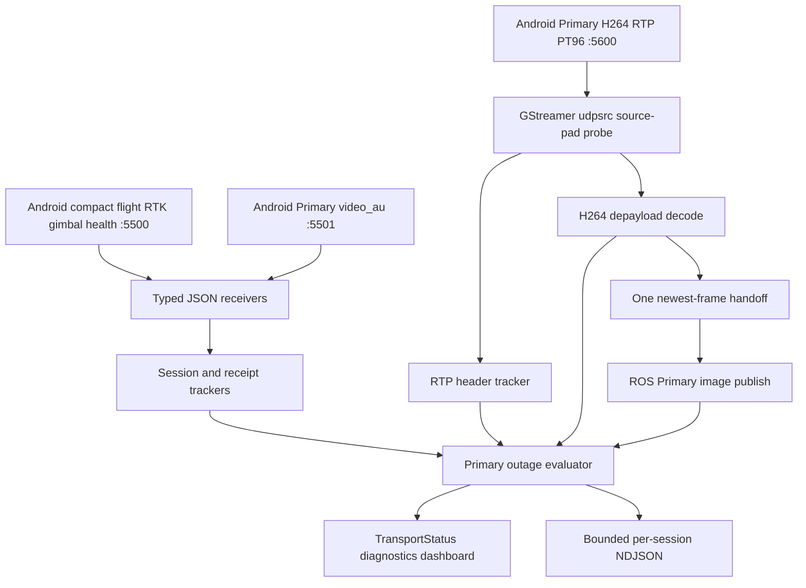

# fix: Complete Primary-only Android Edge contract and transport evidence

## Goal Capsule

- **Objective:** Let an operator and the Edge team identify the first observable non-progressing boundary of a Primary-video interruption — Android local sender counters, Edge JSON/RTP receipt, H.264 recovery, or ROS publication — without disrupting the working low-latency ROS path. A sender-versus-Wi-Fi cause remains explicitly indeterminate unless direct evidence supports it.
- **Means:** Preserve the committed newest-frame Primary baseline, make `dji_edge_transport` conform exactly to the confirmed Android Primary-only protocol, and publish bounded sender-side and Edge-side observations through ROS status, the local dashboard, and per-session NDJSON evidence. (KTD1–KTD7)
- **Authority:** The Android app owns DJI callbacks, RTP packetization, and Android monotonic timestamps. `dji_edge_transport` owns only Edge receipt, decode, ROS delivery, and diagnostic observations. The operator starts/stops transport; this work never emits aircraft or camera commands.
- **Execution profile:** Start from the committed current-frame baseline `a6656a3`, characterize it first, then make the protocol/evidence changes in small units with unit tests before a props-off tablet/Ubuntu bench. Do not reopen the removed legacy transport package.
- **Stop conditions:** Do not change Android, UDP port numbers, RTP payload type, mapper behavior, ROS topic names, flight control, raw RTP capture defaults, FPV transport, or add another UDP listener to port `5600`.

---

## Product Contract

### Summary

The Edge accepts a compact, Primary-only Android transport contract and exposes truthful end-to-end evidence for the one supported video feed.

It must make clear which observations are Android pre-network sender counters and which are Edge post-network ingress, decoder, and ROS-publication counters.

The dashboard remains an observer: video, telemetry, and ROS continue if the dashboard is absent or a browser is closed.

### Problem Frame

The Primary decoder and ROS publication path already have useful current-frame work in progress, but the live contract is inconsistent with the Android sender that is now in use.

`docs/PROTOCOL_V1.md` still declares FPV/port `5610` and Secondary health fields, while Android intentionally sends only Primary RTP on `5600`.

The current generic telemetry decoder accepts `health` because it has the common envelope, but it has no dedicated model. `health` is not added to source-time history, yet its receipt can still trigger publication of the latest prior navigation state. That makes sender evidence look like a navigation update and prevents health from being displayed as a distinct observation.

Finally, `SourceTimeState` keeps per-type history without a session boundary, so a Cendence/USB reconnect can combine a new flight callback with RTK or gimbal values from a previous Android session. A simple reset is also insufficient: a delayed UDP datagram from a retired session must not reactivate that old session.

When Primary appears frozen, the current dashboard can show GStreamer pad-probe ingress, decoded images, and ROS publications, but cannot safely distinguish Android sender progress, metadata progress, RTP sequence discontinuities, an interruption episode, or a session transition.

### Key Decisions

- KD1. **Primary only is the current Edge video scope.** `(session-settled: user-directed — FPV transport is removed for now; local FPV may remain an Android UI concern.)` Governs R1, R2, R7.
- KD2. **Observe the existing GStreamer ingress rather than bind a competing RTP socket.** `(session-settled: user-directed — diagnostics must not become a new source of port contention or packet loss.)` Governs R4, R5, R8.
- KD3. **Keep normal evidence compact and structured.** `(session-settled: user-approved — NDJSON records health, counters, state changes, and incidents; raw RTP remains opt-in bench capture only.)` Governs R5, R6, R8.

### Requirements

**Wire contract and session safety**

- R1. `dji_edge_transport` accepts exactly the active Android contract: compact `flight`, `rtk`, `gimbal`, and `health` JSON on UDP `5500`; Primary `video_au` metadata on `5501`; clock on `5502`; and Primary H.264/RTP payload type `96` on `5600`.
- R2. The Edge rejects FPV/Secondary transport metadata and does not bind, document, display, or expect port `5610`.
- R3. A new Android `session` atomically resets session-dependent telemetry composition, metadata correlation, sequence observations, and incident attribution before new values are published. The active session transition policy retains a bounded set of retired session identifiers, so a stale datagram cannot reactivate an old session or become the position, gimbal angle, or video context of the new session.

**Truthful fault localization**

- R4. Sender health, Edge JSON receipt, GStreamer ingress, RTP-header continuity when safely observable, metadata, decode, and ROS publication are represented as separate observations with clear names and ages. Android counters prove only local Android progress; Edge counters prove only Edge receipt or later progress. No metric claims that a specific Android send was received by Ubuntu.
- R5. A Primary interruption produces one bounded incident record on state transition and one recovery record when the path resumes. The record identifies the first non-progressing boundary and its confidence, without retaining RTP/H.264 payloads.
- R6. The local Edge dashboard and ROS `TransportStatus` make the current condition legible without polling or blocking the media path, and per-session NDJSON gives the Edge agent durable evidence for after-the-fact diagnosis.

**Reliability and continuity**

- R7. Existing Primary behavior remains a single direct GStreamer pipeline, one newest-frame handoff, event-driven ROS delivery, headless decode, and current ROS topics. The dashboard cannot restart, throttle, or otherwise control the live pipeline.
- R8. All diagnostic state, queues, and evidence writing are bounded. A slow disk, a stalled dashboard client, malformed JSON, RTP loss, packet reordering, or a missing keyframe cannot grow memory or block UDP/GStreamer/ROS callback threads.

**Explicit non-goal: precise frame georeferencing**

- R9. This plan must not claim a safe Access Unit → decoded-image identity or a precise image-to-navigation association. The current `FrameContext` remains explicitly unavailable until a separate design proves a one-to-one association from Android `video_au` through GStreamer decode. Health, metadata and RTP observations may be labelled `direct`, `recent-metadata`, or `unavailable` for diagnostics only; none may be used as a georeferencing truth source.

### Key Flows

- F1. **Healthy Primary session:** Android reports compact health and Primary metadata; GStreamer observes Primary RTP; images decode and publish. Dashboard and ROS status show sender and Edge rates separately, with a current session and no active incident. Covers R1, R4, R6, R7.
- F2. **Interruption with bounded attribution:** Android health/metadata or GStreamer RTP ceases progressing. The Edge emits one transition record with the last known observations, identifies the first non-progressing observable boundary, labels any sender-to-Edge inference as qualified/indeterminate, remains ready for a future IDR, and emits recovery evidence after progress resumes. Covers R4–R8.
- F3. **Cendence/USB reconnection:** Android begins a new transport session. The Edge discards old session correlation/history, starts a new evidence directory, retains its listening sockets and waits for fresh telemetry, metadata, RTP, and an IDR. Covers R3, R5, R7.

### Acceptance Examples

- AE1. **Health is sender evidence, not navigation:** given a valid `health` datagram with current sender counters, when Edge receives it, then it appears in health evidence/dashboard state but cannot overwrite navigation or gimbal state. Covers R1, R4.
- AE2. **No mixed-session path:** given `flight` from session A followed by `rtk` from session B, when session B becomes active, then the Edge publishes no composed navigation sample until session-B flight provides the required fields. Covers R3.
- AE3. **RTP loss recovery:** given fresh Android health and metadata but stale GStreamer RTP, when the stale threshold is crossed, then one incident is recorded as an Android-local-progress / Edge-ingress gap with explicitly qualified correlation, not as proven Wi-Fi loss. When RTP and a decodable IDR return, one recovery record is written. Covers R4–R6.
- AE4. **Decode recovery:** given fresh GStreamer RTP but no fresh decoded image after the configured recovery window, when the pipeline has no GStreamer error, then status says it is awaiting decodable H.264/IDR rather than falsely reporting a network or ROS failure. Covers R4–R6.

### Scope Boundaries

- No FPV/Secondary RTP, port `5610`, extra decoder, preview window, re-encoder, relay, raw RTP recording by default, or mapper changes.
- No Android code change, DJI command, camera configuration, mission behavior, flight restriction, or network auto-configuration.
- No false claim of per-frame Android-to-Edge correlation until the GStreamer source-pad buffer is proven to retain a complete RTP datagram and its header can be parsed safely.
- No false claim that a decoded image belongs to a specific Android Access Unit. This requires a later, separately reviewed association design; the current plan keeps `FrameContext` unavailable rather than guessing.
- This plan does not make UDP reliable. It makes loss and recovery observable and preserves the current `wait-for-keyframe` behavior.

### Sources and Research

- `src/dji_edge_transport/src/transport_node.cpp` currently owns UDP JSON receipt, GStreamer/ROS status, the one-item handoff, and dashboard state.
- `src/dji_edge_transport/src/primary_video_pipeline.cpp` owns the only bound RTP socket through GStreamer `udpsrc`; its source-pad probe already counts buffers and bytes.
- `src/dji_edge_transport/src/protocol_decoder.cpp` currently accepts compact flight/RTK/gimbal fields but has no dedicated `health` model.
- `src/dji_edge_transport/src/source_time_state.cpp` bounds history by count but does not scope it by Android session.
- `src/dji_edge_transport/src/udp_receiver.cpp` receives `5500`/`5501`/`5502` JSON with a bounded datagram size but currently drops source-address information.
- Commit `a6656a3` is the current-frame baseline: it already contains the one-item handoff, event-driven delivery worker, headless decoder selection, ingress counters, and bounded GStreamer error text.

---

## Planning Contract

### Key Technical Decisions

- KTD1. **Treat commit `a6656a3` as the prerequisite baseline.** Review the committed files and tests against the current-frame plan before adding protocol work. Keep its one-item `FrameHandoff`, event-driven delivery worker, headless decoder selection, source-pad byte counter, and status additions when characterization passes; do not reimplement them in this plan.
- KTD2. **Use typed, strict packet decoders.** Introduce separate compact models for navigation telemetry, sender health, metadata, and clock. Validate `type`, exact `stream`, session, sequence, field types, finite numbers, and maximum size at the receiver boundary. `health` must never call navigation publication. This prevents unexpected JSON from becoming navigation and preserves sender counters as sender-only evidence.
- KTD3. **Use the GStreamer `udpsrc` source-pad probe as the only RTP observation point.** Extend that probe only with constant-time header parsing after mapping the buffer. Do not open a second `recvfrom`/`UdpReceiver` on `5600`. If a GStreamer buffer cannot be proven to be a whole RTP datagram, expose packet-header continuity as unavailable instead of guessing.
- KTD4. **Make correlation explicit and confidence-rated.** Android `session` arrives via JSON, while RTP itself carries SSRC/timestamp but not Android session. Associate active metadata/health to RTP only inside a bounded recency window and publish `direct`, `recent-metadata`, or `unavailable` correlation confidence rather than inventing certainty.
- KTD5. **Write only state-transition evidence.** A small background evidence writer receives immutable snapshots through a bounded queue. It writes session-scoped NDJSON for startup, session changes, health/metadata/RTP/decode/publication state changes, errors, incidents, and recoveries. It does not write every RTP packet, every decoded frame, source payloads, or raw video.
- KTD6. **Use one health state machine.** Derive `WAITING_FOR_UDP`, `WAITING_FOR_KEYFRAME`, `DECODING`, `PUBLISHING`, `DELIVERY_STALLED`, `PIPELINE_ERROR`, plus an explicit fresh-RTP/no-decode state. Stale windows are parameters with documented defaults, calibrated from a healthy bench before declaring a fault category.
- KTD7. **Keep diagnostic correlation separate from frame identity.** A metadata or health recency match is useful for incident classification only. It must never populate a precise `FrameContext`, select navigation for an image, or replace an Android/DJI timestamp.

### High-Level Technical Design

The JSON receiver's source address is receipt evidence for telemetry and metadata only.

The GStreamer source-pad probe is receipt evidence for video delivered to the decoder graph.

The plan deliberately does not assert that those two paths can prove the same Wi-Fi datagram source without an implementation-time GStreamer capability check.

### Dependencies and Sequencing

1. Validate the committed current-frame baseline first, because it changes the same pipeline, handoff, status, dashboard, CMake, and test surfaces that later units extend.
2. Align the contract and create typed session-aware receipt state before presenting any operator dashboard. Otherwise the UI would display stale/invalid data as live.
3. Add bounded RTP/metadata observations next, then derive incident states from those observations.
4. Expand ROS status, dashboard, and NDJSON only after state semantics are tested.
5. Run container tests and a controlled props-off bench before any field assertion. Physical sender vs Wi-Fi diagnosis remains hardware evidence, not source proof.

### Risks and Mitigation

| Risk | Mitigation |
| --- | --- |
| Committed Edge baseline is overwritten or duplicated | U1 validates commit `a6656a3` against the current-frame plan and preserves already-correct work. |
| A diagnostic receiver competes with GStreamer for `5600` | Only the existing GStreamer `udpsrc` binds media; source-pad inspection replaces a second socket. |
| Android and Edge sessions are falsely correlated | Metadata/health association is bounded and labelled with confidence; session transitions clear state. |
| Delayed UDP packet revives a prior session | Retain a bounded retired-session set and reject packets from it; test the transition explicitly. |
| Evidence causes video stutter or disk growth | A bounded background writer records transitions/snapshots only, rotates files, and drops evidence with a counter rather than blocking media. |
| Loss appears as decoder failure | State machine retains separate ages for sender health, metadata, RTP ingress, decoded image, and ROS publication; an error is only asserted when its direct observation supports it. |
| Diagnostic correlation is mistaken for image identity | Keep `FrameContext` unavailable and state in every status/document that precise AU-to-image association is out of scope. |

---

## Implementation Units

### U1. Validate and freeze the committed current-frame baseline

- **Goal:** Preserve the committed one-frame/event-driven Primary work and establish its actual behavior before layering contract changes onto it.
- **Requirements:** R7, R8.
- **Files:** `src/dji_edge_transport/src/transport_node.cpp`, `src/dji_edge_transport/src/primary_video_pipeline.cpp`, `src/dji_edge_transport/include/dji_edge_transport/{transport_node.hpp,primary_video_pipeline.hpp}`, `src/dji_edge_transport/test/test_primary_video_pipeline.cpp`, `src/dji_edge_transport/CMakeLists.txt`, `docs/plans/2026-09-11-1409-feat-current-frame-video-stability-plan.md`.
- **Approach:** Compare baseline commit `a6656a3` to the current-frame plan. Retain the one-item `FrameHandoff`, event-driven delivery thread, headless decoder selection, source-pad byte counter, and status additions where source and tests agree. Resolve only mismatches, races, shutdown ordering, or missing tests discovered in that comparison. This unit is validation, not a rewrite and not a legacy-package migration.
- **Test scenarios:** latest frame replaces an older pending frame; no timer is needed to publish an already decoded frame; shutdown wakes and joins the delivery thread; GStreamer source observation increments packets/bytes; decoder error text is bounded; CPU fallback remains truthful.
- **Verification:** All existing `dji_edge_transport` tests pass before protocol changes. A props-off baseline demonstrates active ingress, decode, publish, and no uncontrolled frame backlog.

### U2. Make the Primary-only Android protocol strict and session-safe

- **Goal:** Replace generic JSON interpretation with typed Primary-only packet models and prevent prior-session telemetry from leaking into a new session.
- **Requirements:** R1, R2, R3, R4, R8.
- **Files:** `src/dji_edge_transport/include/dji_edge_transport/protocol_decoder.hpp`, `src/dji_edge_transport/src/protocol_decoder.cpp`, `src/dji_edge_transport/include/dji_edge_transport/source_time_state.hpp`, `src/dji_edge_transport/src/source_time_state.cpp`, `src/dji_edge_transport/src/transport_node.cpp`, `src/dji_edge_transport/src/clock_pinger.cpp`, `src/dji_edge_transport/test/test_protocol_decoder.cpp`, `src/dji_edge_transport/test/test_source_time_state.cpp`, `src/dji_edge_transport/test/test_transport_node.cpp`, new `src/dji_edge_transport/test/test_clock_pinger.cpp`, `docs/PROTOCOL_V1.md`.
- **Approach:** Add a `HealthPacket` whose fields are exactly the confirmed active Android Primary counters: `primary_video_callbacks`, `primary_video_callback_drops`, `primary_rtp_packets`, `primary_access_units`, `telemetry_queue_drops`, `telemetry_socket_errors`, and `video_socket_errors`. Require `v=1`, `type=health`, `stream=health:0`, session, monotonic `seq`, `rx_mono_ns`, and a typed `data` object; do not require telemetry `data.fields`. Keep `flight`, `rtk`, and `gimbal` strict to their documented streams and fields. Route health only to sender-observation state: it must not update `latest_telemetry_`, `SourceTimeState`, navigation publication, or `FrameContext`. On a new session, atomically reset `SourceTimeState` and all metadata/receipt/incident state, then record the prior session in a bounded retired-session set. Reject delayed packets from retired sessions and reject invalid sequence progress within the active logical stream. Update protocol documentation so the declared wire format matches emitted Android JSON, including the absence of `5610`.
- **Test scenarios:** valid compact flight, RTK, gimbal, and health packets matching Android fixtures; missing/wrong stream; invalid field type, NaN-equivalent input, missing session, missing `rx_mono_ns`, oversized JSON, duplicate/reordered sequence; health receipt cannot publish navigation; `video_au feed=fpv` rejection; new-session flight with old-session RTK/gimbal cannot compose a navigation sample; old-session packet after transition is rejected and cannot reactivate the session; new session accepts fresh valid samples; a real UDP test peer receives `clock_ping` from the pinger's ephemeral socket and returns `clock_pong` to that same source endpoint.
- **Verification:** Decoder and node tests prove health is sender-only evidence, no historical or retired session sample is used after a transition, and all four transport ports are the only documented ports. The clock test proves Edge accepts Android's reply on the pinger's ephemeral source socket rather than incorrectly requiring the fixed Edge listener on `5502`.

### U3. Add bounded receipt, metadata, and RTP-header observations

- **Goal:** Measure each observable boundary of the Primary path without consuming the stream twice or retaining video payloads.
- **Requirements:** R3, R4, R8.
- **Files:** `src/dji_edge_transport/include/dji_edge_transport/udp_receiver.hpp`, `src/dji_edge_transport/src/udp_receiver.cpp`, `src/dji_edge_transport/include/dji_edge_transport/primary_video_pipeline.hpp`, `src/dji_edge_transport/src/primary_video_pipeline.cpp`, new `src/dji_edge_transport/include/dji_edge_transport/{receipt_tracker.hpp,rtp_ingress_tracker.hpp}`, new `src/dji_edge_transport/src/{receipt_tracker.cpp,rtp_ingress_tracker.cpp}`, `src/dji_edge_transport/src/transport_node.cpp`, `src/dji_edge_transport/test/test_udp_receiver.cpp`, new `src/dji_edge_transport/test/{test_receipt_tracker.cpp,test_rtp_ingress_tracker.cpp,test_primary_video_pipeline.cpp}`, `src/dji_edge_transport/CMakeLists.txt`.
- **Approach:** Carry peer IPv4/port and Edge monotonic receipt time from `UdpReceiver` for JSON only. Track accepted/rejected receipt counts, last receipt age, sequence gaps/duplicates/reorders, and active session per telemetry/metadata logical stream. Before implementing any RTP sequence metric, add a focused capability check proving whether each `primary_source` probe buffer is one complete UDP/RTP datagram. Only if proven, map the first bounded RTP header bytes, validate RTP version/payload type/header length, and track SSRC, sequence/timestamp continuity, packet/byte rate, malformed-header count, and last ingress time. Otherwise expose `rtp_header_continuity_available=false` and retain existing packet/byte/age observations. Do not retain the buffer, parse H.264 payload, or infer image identity.
- **Test scenarios:** UDP source endpoint is captured for valid/invalid datagrams; receipt counters remain bounded under malformed input; probe capability test for complete-datagram semantics; when capability is proven, RTP basic header, CSRC/extension header, invalid version/PT, sequence wrap, duplicate, reordering, loss gap, SSRC change, and truncated buffer; source-pad probe still only has one media socket and still feeds the existing decoder.
- **Verification:** The status snapshot distinguishes JSON receipt from GStreamer ingress and either reports tested RTP-header continuity or explicitly reports it unavailable. No code path opens `UdpReceiver` or another `recvfrom` listener on `5600`.

### U4. Evaluate Primary interruptions and persist per-session evidence

- **Goal:** Turn separate counters into one precise, non-spammy incident/recovery record that identifies the first observed boundary and guides the next Android, network, or decoder investigation without falsely proving an upstream cause.
- **Requirements:** R3–R6, R8, R9.
- **Files:** new `src/dji_edge_transport/include/dji_edge_transport/{primary_health_evaluator.hpp,session_evidence_writer.hpp}`, new `src/dji_edge_transport/src/{primary_health_evaluator.cpp,session_evidence_writer.cpp}`, `src/dji_edge_transport/include/dji_edge_transport/transport_node.hpp`, `src/dji_edge_transport/src/transport_node.cpp`, `src/dji_edge_transport/config/transport.yaml`, new `src/dji_edge_transport/test/{test_primary_health_evaluator.cpp,test_session_evidence_writer.cpp}`, `src/dji_edge_transport/CMakeLists.txt`.
- **Approach:** After U2 proves that health and session state are valid, define one immutable snapshot containing Android health, JSON receipt, metadata, GStreamer ingress/RTP-header capability, decode, ROS publish, clock, session, and errors. Derive states only from fresh/stale observations with configurable, documented windows: no RTP yet; RTP awaiting IDR; fresh RTP but decode stale; decoded but ROS delivery stale; pipeline error; publishing. Start one incident only on entry to a degraded state, append its bounded snapshot to the active session evidence file, and close it once recovery is observed. Create a session directory only after a valid session transition and rotate NDJSON within an explicit size/count budget. The writer runs on a bounded background queue; dropped evidence is counted and surfaced. Confidence labels describe diagnostic correlation only and cannot populate `FrameContext` or assert AU-to-image identity.
- **Test scenarios:** first packet/keyframe/publish transitions; fresh Android health plus stale GStreamer ingress; fresh RTP plus stale decode; fresh decode plus stale publish; pipeline error; state flapping does not create unbounded records; recovery creates exactly one recovery record; session change closes old incident and starts fresh state; evidence writer rotates and drops safely under an intentionally blocked writer.
- **Verification:** A unit-test clock can advance each boundary deterministically. Evidence never includes RTP/H.264 payload bytes. Any causal label that relies only on recent metadata/health declares its correlation confidence.

### U5. Expose a compact operator dashboard and ROS diagnostic contract

- **Goal:** Make the supported Primary path understandable in the dashboard and ROS without creating a second video viewer or coupling the observer to transport health.
- **Requirements:** R4, R5, R6, R7, R8.
- **Files:** `src/dji_edge_transport/msg/TransportStatus.msg`, `src/dji_edge_transport/include/dji_edge_transport/transport_node.hpp`, `src/dji_edge_transport/src/transport_node.cpp`, `src/dji_edge_transport/include/dji_edge_transport/dashboard_server.hpp`, `src/dji_edge_transport/src/dashboard_server.cpp`, `src/dji_edge_transport/test/test_transport_node.cpp`, new `src/dji_edge_transport/test/test_dashboard_server.cpp`, `src/dji_edge_transport/CMakeLists.txt`.
- **Approach:** Extend status and `/v1/state` with four clearly labelled groups: `connection` (listener/bind/session/peer evidence), `android_sender` (health counters and age), `primary_edge` (metadata, RTP ingress, sequence capability, decode, publish, resolution, rates, and errors), and `incident_clock` (state/reason/episode/correlation/clock/evidence-writer drops). Keep the dashboard loopback-only and read-only except its existing next-launch clock-host preference. Replace the raw JSON-only page with compact cards/tables that poll `/v1/state`; rendering failures or slow clients must not affect the transport node.
- **Test scenarios:** state JSON contains no Secondary/FPV fields; waiting/IDR/decode/publish/error conditions render the correct group and severity; dashboard failure does not affect status publication; a slow/invalid HTTP request cannot block the media thread; clock is shown as unavailable without preventing video status.
- **Verification:** A fresh operator can tell whether Android has sent health/metadata, whether GStreamer saw RTP, whether H.264 decoded, and whether ROS published without interpreting raw counters. The dashboard contains no video preview, no controls for the pipeline, and no reference to port `5610`.

### U6. Align documentation, fixtures, and staged field verification

- **Goal:** Give the Edge agent an unambiguous implementation and bench contract so the next diagnosis uses comparable evidence rather than stale port/schema assumptions.
- **Requirements:** R1, R2, R4–R8.
- **Files:** `docs/PROTOCOL_V1.md`, `docs/PRIMARY_CPP_BENCH.md`, `README.md`, `docs/transport-contract-fixtures/primary-only/*.json` (new canonical fixtures), `src/dji_edge_transport/test/test_protocol_decoder.cpp`, `src/dji_edge_transport/test/test_primary_health_evaluator.cpp`.
- **Approach:** Replace all FPV/Secondary/`5610` references with an explicit Primary-only statement. Document the four ports, canonical Android-emitted JSON schemas, source-vs-Edge observation boundary, clock reply-to-ephemeral-source contract, active/retired-session behavior, RTP-header capability flag, diagnostic correlation confidence, the explicit lack of AU-to-image identity, incident schema, evidence location/retention, and the exact distinction between healthy, awaiting IDR, decode stalled, delivery stalled, and pipeline error. Use small JSON fixtures copied from the Android contract and shared by protocol tests and documentation examples.
- **Test scenarios:** documentation fixtures parse in protocol tests; no documentation/config/test production path names `5610`, `fpv`, or `secondary` as a supported Edge feed; fixtures include exactly the seven health counters emitted by Android; bench checklist covers baseline, interruption, recovery, restart/session transition, clock optionality, RTP-header capability outcome, and ten-minute soak.
- **Verification:** A separate Edge agent can configure and validate the stack without needing Android source access, and can report the first non-progressing boundary with a session ID and evidence file.

---

## Verification Contract

| Gate | Applies after | Evidence required |
| --- | --- | --- |
| Current-frame baseline suite | U1 | All `dji_edge_transport` tests at baseline commit `a6656a3` pass in the project Humble container; no legacy package is built or revived. |
| Protocol/fixture tests | U2, U6 | Strict Primary-only JSON acceptance/rejection, health routing, session reset, and documented fixture parsing pass. |
| Tracker/evaluator tests | U3, U4 | Deterministic timestamped scenarios prove RTP header handling, state transitions, bounded incident count, writer rotation, and no payload retention. |
| ROS/dashboard tests | U5 | `TransportStatus` and `/v1/state` expose every documented group, remain observer-only, and contain no Secondary/FPV fields. |
| Props-off tablet baseline | U6 | One session records current health, metadata, RTP ingress, nonzero decoded/published Primary frames, navigation fallback behavior, and optional clock state. |
| Controlled interruption bench | U6 | A short, non-flight network interruption or receiver pause produces one incident and one recovery with the first non-progressing boundary identified. |
| Ten-minute real-network soak | U6 | Primary remains current or every interruption is bounded and explained by evidence; no queue growth, disk runaway, dashboard-induced disruption, or unreported pipeline error occurs. |

The implementation agent should use the repository's Humble Docker workflow specified by `AGENTS.md` for builds/tests.

Physical proof is required before claiming Android-to-Edge Primary transport is reliable; passing C++ tests proves only the Edge behavior in isolation.

---

## Definition of Done

- U1. Baseline commit `a6656a3` is characterized, tested, and preserved without duplicating transport/pipeline ownership or reviving legacy code.
- U2. The Edge strictly supports only the compact Primary-only Android contract, routes health only as sender evidence, and cannot mix or reactivate telemetry across sessions.
- U3. JSON receipt and media ingress measurements are distinct; RTP-header tracking is either tested and enabled or explicitly unavailable after the GStreamer-buffer capability check; no second media receiver exists.
- U4. Degraded/recovery episodes create bounded, session-scoped NDJSON evidence and never retain raw video or block a live path.
- U5. ROS status and the loopback dashboard display truthful grouped observations, no FPV/Secondary state, and no operational control that can disrupt transport.
- U6. Docs, fixtures, and bench instructions match the emitted Android contract exactly.
- `FrameContext` remains explicitly unavailable; no code or documentation claims precise Access Unit → decoded-image or image-to-navigation association from this work.
- All selected tests/builds pass in the project container, the props-off baseline and controlled interruption checks have been recorded, and the ten-minute soak has either passed or left a named evidence-backed blocker.
- The final diff contains no abandoned second-receiver experiment, stale FPV contract prose, debug payload capture, or unbounded diagnostic path.

## Appendix

### Current Code Findings That Drive This Plan

- `src/dji_edge_transport/config/transport.yaml` already declares only the expected Primary ports (`5500`, `5501`, `5502`, `5600`); the stale `5610` claim is documentation-level, not a current listener configuration.
- `src/dji_edge_transport/src/primary_video_pipeline.cpp` already places a probe directly after GStreamer `udpsrc`, which is the correct single ingress observation point. It currently counts only buffer count/size, not header continuity.
- `src/dji_edge_transport/src/protocol_decoder.cpp` accepts unknown non-video/clock types as telemetry. Android `health` includes the common session/timestamp envelope, so it is currently accepted without a dedicated model and can trigger an old-navigation republish.
- `src/dji_edge_transport/src/source_time_state.cpp` discards samples by type/timestamp but has no active-session or retired-session policy.
- `src/dji_edge_transport/src/dashboard_server.cpp` is already isolated on loopback and only observes state. Its current raw JSON view is safe but insufficiently legible for field fault localization.
- `src/dji_edge_transport/src/transport_node.cpp` currently stores only the latest metadata and does not turn it into receipt/correlation counters or a session transition boundary.

### Edge Agent Handoff

Start with U1 and preserve the committed baseline `a6656a3`; do not treat this plan as authority to resurrect the removed legacy driver.

Do not run U3's RTP-header parser as a reason to bind `5600` twice: the only valid media owner remains GStreamer `udpsrc`.

Do not label a GStreamer ingress lapse as Wi-Fi loss unless same-session Android sender health/metadata is fresh within the documented correlation window; otherwise report the observation boundary as indeterminate.

Do not fill `FrameContext` from last-seen metadata, RTP timestamp recency, clock offset, or latest navigation. That would create a plausible-looking but unsafe georeferencing record. Keep it unavailable until a dedicated association design and proof are approved.

Do not claim the system reliable after compilation. The required final evidence is a session-scoped healthy baseline, controlled interruption/recovery, and a ten-minute real-network soak.

---

## Execution Record — 2026-09-14

### Implemented and software-verified

- U1 baseline behavior remains intact: one-item newest-frame handoff, event-driven ROS delivery, one GStreamer media owner, headless decode selection, and bounded pipeline error text.
- U2 now decodes only the strict Primary contract. `health` has its own typed model and cannot update `SourceTimeState`, navigation, or `FrameContext`. Active session transitions reset dependent state; bounded retired sessions and per-logical-stream sequence checks reject stale revival.
- Clock ping is verified against a real local UDP responder returning its `clock_pong` to the pinger's ephemeral source endpoint.
- U3 captures JSON receipt peer IPv4/port for telemetry and metadata, while RTP remains observable only from the existing GStreamer source-pad probe. RTP continuity tracks only validated headers and retains no payload; no second receiver binds `5600`.
- U4 uses a small, deterministic `PrimaryHealthEvaluator` with configurable `primary_stale_after_s=1.0` and `sender_correlation_s=2.0` defaults. It distinguishes no UDP, awaiting IDR, fresh RTP with decode stalled, ROS delivery stalled, publishing and pipeline error. A bounded writer records one incident per degraded episode and one recovery only after publishing resumes; a qualified Android-local-progress / Edge-ingress gap never asserts Wi-Fi loss.
- U5 exposes the four observer-only groups `connection`, `android_sender`, `primary_edge`, and `incident_clock` through ROS status and loopback dashboard state. The dashboard has no video branch or live-pipeline control.
- U6 aligns the docs and compact fixtures with the active Primary-only contract. The fixtures are parsed by the C++ protocol tests and use one coherent Android session.

### Verification evidence

- Humble container build and full selected test suite: **47 tests, 0 failures**.
- Installed-node smoke test on isolated ports: loopback dashboard served the four documented groups and correctly reported `waiting_for_udp` without media traffic.
- Isolated UDP contract smoke: `flight`, `health`, `rtk`, `gimbal`, and `video_au` fixtures produced active session `fixture-session`, `health_count=1`, `metadata_count=1`, and a session-scoped `primary_incident` NDJSON record.
- All smoke processes were terminated after verification. No user-facing transport port or Android/tablet state was touched.

### Still required before a reliability claim

- Props-off tablet/Ubuntu Primary baseline with the actual Android sender.
- Controlled interruption followed by IDR/decode recovery, checking exactly one incident and one recovery record.
- Ten-minute real-network soak with the dashboard/evidence counters monitored.

These three remaining gates are physical-system evidence, not a software blocker. They require the tablet/transport to be deliberately available for a bench run.
