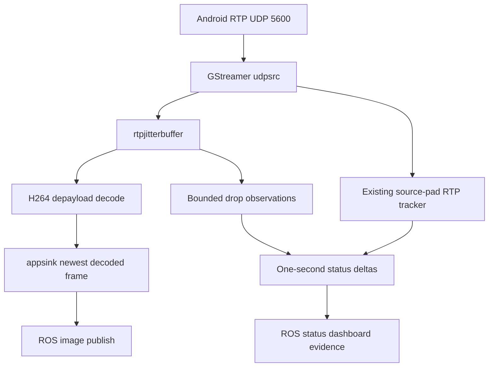

# Bounded Edge Transport Observability - Plan

## Goal Capsule

- **Objective:** Let the field operator and the SDK/Edge reviewers determine whether a visible Primary-video interruption first appears as late RTP at the Edge, an H.264 recovery wait, a ROS delivery stall, or a clock-return failure, without making the live transport slower or less reliable.
- **Means:** Add bounded, low-rate observability to the existing single GStreamer receiver and status path; retain the current direct Primary pipeline, newest-frame handoff, and session evidence. (KTD1–KTD4)
- **Authority:** `docs/TRANSPORT_RESOLUTIONS_AND_OPEN_ISSUES.md` is the current diagnostic evidence source. The Android repository owns DJI callbacks, packetization, Android sender counters, and clock replies. This plan changes only `dji_edge_transport`.
- **Execution profile:** Characterization-first. The implementation must preserve the current working video path, test deterministic counters before a tablet bench, and make no claim that an Edge metric proves Wi-Fi loss without paired Android/PCAP evidence.
- **Stop conditions:** Stop and revise rather than guessing if GStreamer cannot expose the intended drop-message fields on the installed Humble runtime, if enabling observation changes the media topology, or if the proposed counters require another receiver/socket on UDP 5600.

---

## Product Contract

### Summary

The Edge already has one direct Primary path:

This plan makes the three observations at the right side truthful and useful. It does not add another media consumer, raw capture, disk recording, preview, or ROS image copy.

### Problem Frame

Current cumulative RTP gaps and a generic decoder state cannot tell an operator whether a temporary video pause came from late packet drops inside `rtpjitterbuffer`, a lack of recoverable H.264/IDR, a ROS delivery failure, or a clock return-path failure. The prior investigation shows that disconnect/detach events were only the deliberate final shutdown, so the next Edge work must distinguish the remaining causes rather than restart or re-architect the decoder.

### Requirements

**Bounded video-path observability**

- R1. The existing GStreamer `rtpjitterbuffer` reports bounded aggregate counts for late/loss/latency drops through the existing bus polling path. It must not add buffering, a second pipeline, a preview branch, or payload retention.
- R2. `TransportStatus` and dashboard state expose one-status-window deltas for RTP ingress packets/bytes, sequence gaps, duplicates, and reordering alongside their existing totals and ages. Existing incident/recovery evidence records the latest scalar values only when it already writes a transition; it does not become a periodic or per-packet log.
- R3. The operator can distinguish these Edge states without raw counter interpretation: no UDP ingress, fresh RTP awaiting recoverable H.264/IDR, decoding, ROS delivery stalled, and pipeline error.

**Clock observability**

- R4. The Edge records aggregate clock ping outcomes: send failure, timeout, malformed or unmatched pong, valid pong, last success age, and RTT. Clock failure must remain independent from Primary video publication.

**Reliability boundaries**

- R5. No part of this plan captures raw RTP/H.264, writes per-packet evidence, opens a competing UDP socket on 5600, changes ports/RTP/timestamps, restarts a decoder on frame loss, or adds a ROS image conversion/copy.
- R6. All new counters are constant-time on the existing source-pad/bus/status paths, bounded in memory, and sampled/published at the existing status cadence. A slow dashboard, evidence writer, or absent clock reply cannot block GStreamer, UDP ingress, decode, or ROS image delivery.

### Acceptance Examples

- AE1. **Late packet visibility:** given `rtpjitterbuffer` emits a rate-limited drop message, when the status timer runs, then the current status-window drop delta and cumulative total are visible in ROS/dashboard; an existing incident/recovery event includes the latest scalar values if it is written. No image payload is stored. Covers R1, R2, R6.
- AE2. **Fresh RTP with no decodable frame:** given ingress remains fresh while decoded age crosses the stale threshold and the pipeline has no GStreamer error, when status is evaluated, then the state is `waiting_for_keyframe` with a separate decoder activity label; it is not labelled Wi-Fi loss or NVIDIA failure. Covers R3, R5.
- AE3. **Clock degradation:** given the pinger times out after a prior valid sample, when video continues decoding/publishing, then clock state becomes stale/degraded while Primary remains publishing. Covers R4, R6.
- AE4. **No competing receiver:** given the package starts, when Primary is inspected, then the only binder on UDP 5600 remains GStreamer `udpsrc`; no `UdpReceiver`, raw capture, or PCAP helper is created. Covers R5.

### Scope Boundaries

- In scope: Primary-only Edge diagnostics under `src/dji_edge_transport/`.
- Deferred: PCAP orchestration, raw RTP bench capture, Android sender changes, Wi-Fi/USB experiments, FPV, frame-to-navigation identity, mapper, dashboard redesign, and any change to bitrate/resolution.
- Outside this plan: decoder restarts, latency increases, additional renderer/relay processes, and changing the Android wire contract.

### Sources and Research

- `docs/TRANSPORT_RESOLUTIONS_AND_OPEN_ISSUES.md` records the three remaining observable interruption classes and the requirement to avoid causal overclaiming.
- `src/dji_edge_transport/src/primary_video_pipeline.cpp` constructs the only RTP pipeline and currently polls only `ERROR`/`EOS` messages.
- `src/dji_edge_transport/src/transport_node.cpp` already computes one-second ingress/decode/publish rates and exposes `state`, `ingress_state`, `decoder_state`, and `ros_delivery_state`.
- `src/dji_edge_transport/src/clock_pinger.cpp` already owns the persistent pinger socket and counters for attempts, successes, and timeouts.
- GStreamer documents `post-drop-messages` as a rate-limited `drop-msg` bus message and `drop-on-latency` as the bound that drops oldest buffers when latency capacity is reached: <https://gstreamer.freedesktop.org/documentation/rtpmanager/rtpjitterbuffer.html>.

---

## Planning Contract

### Key Technical Decisions

- KTD1. **Observe the existing GStreamer bus, not RTP payloads.** Enable rate-limited `rtpjitterbuffer` drop messages and parse only their scalar reason/counter fields in `PrimaryVideoPipeline::poll_bus()`. This reuses the only media owner and avoids competing socket/copy risk. (session-settled: user-directed — no raw RTP recording/capture helper; the user sees no benefit in it for the current transport state.)
- KTD2. **Expose window deltas from existing cumulative trackers.** Store the previous snapshot only in `TransportNode`'s status-rate state and calculate non-negative differences once per status interval. Do not add per-packet evidence writes or a second tracker. (session-settled: user-approved — low-rate aggregated diagnostics are preferable to additional hot-path work.)
- KTD3. **Make packet-loss observations descriptive, never causal.** A jitterbuffer drop or sequence gap is an Edge observation, not proof of Wi-Fi loss. Existing state names and evidence must say `observed at Edge`; Android/PCAP remain required to attribute upstream cause.
- KTD4. **Keep clock status separate from media health.** Extend `ClockPinger` outcome accounting only; do not gate image publication, decoder selection, frame handoff, or ROS QoS on clock readiness.

### High-Level Technical Design

`PrimaryVideoPipeline` remains the single RTP owner. Its source-pad probe continues tracking ingress and header continuity. The jitterbuffer posts an element message no more frequently than a configured interval; `poll_bus()` absorbs it, updates scalar counters under the existing mutex, and continues to handle errors/EOS. `TransportNode::publish_status()` snapshots those counters once and calculates deltas against the previous snapshot for ROS status and dashboard state. The existing transition-only evidence path copies the latest scalars only when it already writes an incident/recovery record. Clock outcome categories are accumulated in `ClockPinger` and only read by the existing status/dashboard code.

### Assumptions

- The installed GStreamer version supports `post-drop-messages` and a `drop-msg` structure. Implementation must verify this in the project Humble container before relying on individual reason fields.
- The status timer remains the existing low-rate publication point. If its cadence is changed elsewhere, deltas must be normalised by elapsed time as current bitrate/FPS already are.
- The existing session evidence writer can accept added scalar fields without recording a new event per RTP packet.

### Dependencies and Sequencing

1. Characterize current test seams and the installed GStreamer drop-message schema.
2. Add bounded jitterbuffer counters with focused pipeline tests.
3. Add status-window delta calculation and surface it consistently in ROS/dashboard/evidence.
4. Add clock outcome classification and isolation tests.
5. Run package/container verification and a controlled bench smoke only after all static contracts pass.

### Risks and Mitigation

| Risk | Mitigation |
|---|---|
| Drop-message schema differs in Humble | Gate implementation on a container inspection/test; retain generic total/unknown count if a reason field is absent rather than parsing undocumented data. |
| Bus messages cause diagnostic spam | Configure a finite `drop-messages-interval`, count scalars only, and publish at the existing status cadence. |
| Counter reset/underflow makes false deltas | Treat a reduced total as reset: publish zero delta and reset the local baseline. |
| Dashboard diverges from ROS state | Make both consume the same `VideoSnapshot`/status fields and cover serialized dashboard JSON in tests. |
| Clock work disrupts Primary | Keep the pinger thread and read-only status path independent; test that video state remains publishing under clock timeout. |

---

## Implementation Units

### U1. Characterize and expose jitterbuffer drop observations

- **Goal:** Add reliable, bounded visibility into packets dropped by the existing jitterbuffer without changing media flow.
- **Requirements:** R1, R3, R5, R6.
- **Dependencies:** None.
- **Files:** `src/dji_edge_transport/src/primary_video_pipeline.cpp`, `src/dji_edge_transport/include/dji_edge_transport/primary_video_pipeline.hpp`, `src/dji_edge_transport/test/test_primary_video_pipeline.cpp`, `src/dji_edge_transport/CMakeLists.txt` only if a required test dependency is already present in the Humble image.
- **Approach:** Keep `udpsrc → rtpjitterbuffer → rtph264depay → h264parse → decoder → appsink` unchanged. Add the GStreamer property that enables rate-limited drop messages to the already configured jitterbuffer. Extend `VideoSnapshot` with scalar cumulative counts by documented reason plus unknown/malformed element-message count. Extend `poll_bus()` to drain `GST_MESSAGE_ELEMENT` alongside `ERROR`/`EOS`, accept only the jitterbuffer drop structure, and ignore unrelated element messages. Do not allocate/store buffer payloads or trigger a pipeline reset.
- **Execution note:** Characterization-first: inspect the exact message structure available in the Humble container before finalizing reason mapping.
- **Test scenarios:** pipeline description contains `post-drop-messages=true` and a finite interval; a synthetic valid drop message increments the intended counter; an unrelated element message is ignored; malformed/missing reason becomes bounded unknown; `ERROR` and `EOS` handling remains unchanged; snapshot copy is thread-safe.
- **Verification:** Focused `test_primary_video_pipeline` proves the source has one `udpsrc`, one `appsink`, no preview/tee/extra receiver, and drop observation cannot cause a state change or payload retention.

### U2. Publish RTP and jitter deltas at the existing status cadence

- **Goal:** Turn the existing cumulative ingress/header/jitter observations into actionable one-window rates/deltas without per-packet diagnostics.
- **Requirements:** R1–R3, R5, R6.
- **Dependencies:** U1.
- **Files:** `src/dji_edge_transport/include/dji_edge_transport/transport_node.hpp`, `src/dji_edge_transport/src/transport_node.cpp`, `src/dji_edge_transport/msg/TransportStatus.msg`, `src/dji_edge_transport/src/dashboard_server.cpp`, `src/dji_edge_transport/include/dji_edge_transport/primary_health_evaluator.hpp` only if a new state label is required, `src/dji_edge_transport/test/test_transport_node.cpp`, `src/dji_edge_transport/test/test_primary_health_evaluator.cpp`.
- **Approach:** Extend the current previous-snapshot state used for ingress bitrate/decode FPS/publish FPS with previous RTP gap/duplicate/reorder and jitterbuffer drop totals. On each status interval calculate non-negative deltas and normalised rates where useful; an apparent counter reset yields zero delta plus a new baseline. Add fields to `TransportStatus` and the dashboard JSON under the existing Primary Edge group. Preserve existing total counters and state names. Include the latest scalar totals/deltas only in the existing incident/recovery evidence record when that record is already emitted; never add periodic or per-packet NDJSON records.
- **Test scenarios:** healthy window has zero loss deltas; one sequence gap/reorder/duplicate produces exactly one matching delta; reason-specific jitterbuffer counts map correctly; a counter reset cannot underflow; dashboard JSON and ROS status expose the same totals/deltas; stale ingress remains `waiting_for_udp`; fresh ingress with stale decode remains `waiting_for_keyframe`.
- **Verification:** Package tests prove no new receiver binds 5600, status rate computation remains elapsed-time based, and source-only evidence cannot state Wi-Fi loss.

### U3. Classify clock outcomes without coupling them to Primary

- **Goal:** Make intermittent clock failure diagnosable as a return-path/protocol observation while preserving uninterrupted video publication.
- **Requirements:** R4–R6.
- **Dependencies:** U2.
- **Files:** `src/dji_edge_transport/include/dji_edge_transport/clock_pinger.hpp`, `src/dji_edge_transport/src/clock_pinger.cpp`, `src/dji_edge_transport/src/transport_node.cpp`, `src/dji_edge_transport/src/dashboard_server.cpp`, `src/dji_edge_transport/test/test_clock_pinger.cpp`, `src/dji_edge_transport/test/test_transport_node.cpp`, `docs/TRANSPORT_RESOLUTIONS_AND_OPEN_ISSUES.md`.
- **Approach:** Preserve the persistent UDP socket and packet matching by edge send timestamp. Separate counters for send failure, receive timeout, decode failure, unmatched pong, and accepted pong; retain a bounded last-error string and last-success monotonic time. Surface these fields in existing clock status/dashboard cards. Do not inspect/change Android code, do not set image state from clock state, and do not add a return receiver on 5502 because the pinger already receives the reply on its ephemeral source socket.
- **Test scenarios:** valid pong increments success and refreshes last-success; timeout increments only timeout; malformed reply increments decode failure; mismatched t0 increments unmatched; socket send failure is distinguished; a mocked clock timeout leaves an otherwise publishing Primary assessment unchanged; dashboard exposes the same outcome counts as ROS status.
- **Verification:** `test_clock_pinger` covers the request/reply contract and `test_transport_node` proves a stale clock changes only clock readiness/diagnostics, never Primary publication state.

### U4. Align the operator contract and run bounded verification

- **Goal:** Ensure code, dashboard labels, and documentation make the new observations useful without claiming causes the Edge cannot prove.
- **Requirements:** R2–R6.
- **Dependencies:** U1–U3.
- **Files:** `docs/TRANSPORT_RESOLUTIONS_AND_OPEN_ISSUES.md`, `docs/PRIMARY_CPP_BENCH.md`, `README.md` if it inventories live diagnostics, `src/dji_edge_transport/test/test_primary_video_pipeline.cpp`, `src/dji_edge_transport/test/test_transport_node.cpp`, `src/dji_edge_transport/test/test_clock_pinger.cpp`.
- **Approach:** Update only the operator-facing field meanings and bench checklist. Define that jitterbuffer drop means late/lost-at-Edge observation, RTP delta means header-tracker observation, `waiting_for_keyframe` means fresh ingress without decodable output, and clock failure is independent. Document that causality still requires a paired Android diagnostic and PCAP; do not revive raw RTP capture as a normal workflow.
- **Test scenarios:** field names appearing in docs match status/dashboard serialization; no documentation tells an operator that gaps prove Wi-Fi; no documentation recommends a second 5600 receiver, raw capture by default, decoder restart, or changing latency as a fix.
- **Verification:** Review the rendered dashboard at normal laptop width with a synthetic fresh/degraded state and run the complete `dji_edge_transport` test suite in the project Humble container.

---

## Verification Contract

| Gate | Applies after | Evidence required |
|---|---|---|
| GStreamer capability gate | U1 | The project Humble container confirms the installed jitterbuffer accepts the selected properties and a focused test captures/parses the actual supported drop message shape. |
| Focused pipeline tests | U1 | `test_primary_video_pipeline` proves one media owner, bounded counters, unchanged error/EOS behavior, and no payload retention. |
| Status/dashboard tests | U2 | `test_transport_node` proves totals/deltas/state consistency; dashboard serialization contains the same Primary values. |
| Clock isolation tests | U3 | `test_clock_pinger` distinguishes all outcome categories and stale clock never changes Primary publish state. |
| Package regression suite | U4 | `colcon test --packages-select dji_edge_transport` passes in the project Humble Docker runtime, followed by `colcon test-result --verbose`. |
| Controlled bench smoke | U4 | With a real tablet stream, dashboard/ROS show fresh ingress, decoder activity, publish activity, zero or nonzero observed drop deltas, and clock outcome separately. No claim of Wi-Fi cause is made without same-session Android/PCAP evidence. |

## Definition of Done

- U1–U4 are implemented in dependency order and all listed tests pass in the Humble container.
- The Primary pipeline still has exactly one UDP 5600 owner, one appsink, newest-frame semantics, no raw RTP capture/recording, no preview branch, no decoder watchdog, and no new ROS image copy.
- Jitterbuffer drop observations, RTP deltas, decoder state, ROS delivery state, and clock outcomes are visible and semantically distinct in ROS status, dashboard, and bounded Edge evidence.
- A counter reset, malformed GStreamer message, missing Android clock reply, or slow dashboard cannot block or restart Primary media flow.
- Documentation tells the operator which conditions are Edge observations and which conclusions still require Android plus PCAP correlation.
- The final diff has no abandoned diagnostics, unbounded event logging, or changes to Android ports/protocol/timestamps.

## Appendix

### Rejected alternatives

- **Automatic PCAP/raw RTP capture:** rejected by the user for this plan. It does not improve the live transport and is not needed to expose bounded Edge observations.
- **Increasing jitter latency:** rejected because it would trade evidence of loss for more stale video and harm spatial synchronization.
- **Decoder restart/watchdog:** rejected because normal UDP/H.264 loss recovers at the next IDR; recreation increases downtime and masks the upstream failure.
- **Second UDP receiver or relay:** rejected because it competes with the sole GStreamer owner of 5600 and adds copying/failure modes.
