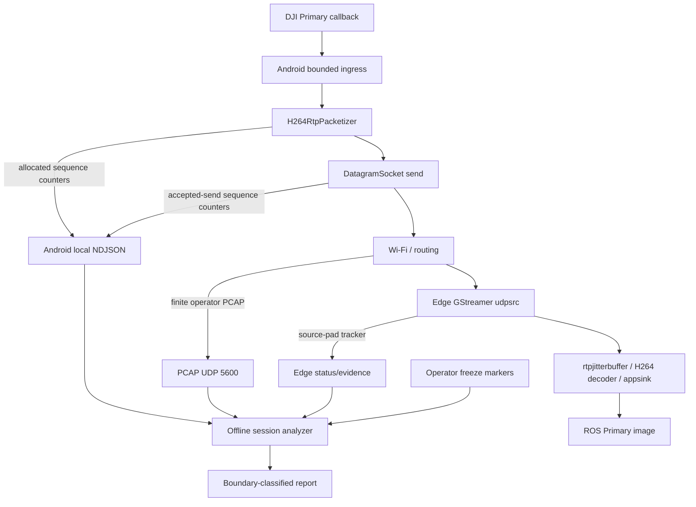

# Primary RTP Gap Origin Investigation Plan

## Goal Capsule

- **Objective:** During a real Primary-video freeze, determine at which boundary RTP continuity first breaks: Android packetizer, Android socket acceptance, network delivery to Ubuntu, or Edge GStreamer ingestion.
- **Means:** Keep the live RTP/ROS pipeline unchanged; add bounded Android sequence evidence, explicitly invoked host PCAP, timestamped Edge transitions, and one offline correlator. (KTD1-KTD4)
- **Authority:** The Android SDK owns DJI callbacks, H.264 access-unit assembly, RTP sequence allocation, and UDP send outcomes. `dji_edge_transport` owns only UDP reception, GStreamer, ROS publication, Edge evidence, and the dashboard. The Android wire contract and ports remain unchanged: telemetry `5500`, frame metadata `5501`, clock `5502`, Primary RTP `5600`.
- **Execution profile:** Characterization first. No bitrate, codec, Wi-Fi, TCP, latency, decoder, or queue tuning is permitted until the same freeze is classified using the evidence below.
- **Stop conditions:** Stop and report rather than infer causality if the Android-side sequence evidence cannot be produced without per-packet disk logging, the host capture would require a competing binder on `5600`, the three artifacts do not share a session/time correlation key, or a deliberate aircraft shutdown cannot be distinguished from an unintended interruption.

---

## Product Contract

### Summary

The current session showed repeated Edge gaps while the final permanent loss of video was caused by the operator turning the aircraft off. These are separate events.

The relevant observed intermediate pattern is:

```mermaid
sequenceDiagram
  participant A as Android packetizer and sender
  participant N as Wi-Fi and route
  participant E as Edge udpsrc tracker
  participant G as GStreamer decoder
  participant R as ROS image

  A->>N: RTP sequence N through N+k
  Note over E: No RTP ingress for more than 1 s
  Note over G,R: Freeze; waits for a recoverable H.264 picture
  N-->>E: RTP resumes at N+k+m
  E->>E: Observes m missing sequence values
  E->>G: Fresh RTP resumes
  G->>R: Publishes newest recoverable frame
```

The Edge's source-pad tracker runs before `rtpjitterbuffer`; its gaps mean a header sequence discontinuity was observed at `udpsrc`. They do not prove whether packets were lost in Wi-Fi or skipped before Android's socket. The Android's existing `socket.send()` acceptance counters also do not prove delivery to Ubuntu. The plan closes that evidence gap.

### Requirements

**Evidence boundaries**

- R1. A 1 Hz Android-local `transport_pulse` records bounded RTP sequence allocation and accepted-send continuity for Primary without recording RTP payloads, packet lists, or new network messages.
- R2. Every Edge incident/recovery evidence record includes diagnostic observation time in both Edge monotonic time and UTC epoch milliseconds. These values must never replace Android/DJI source timestamps in `FrameContext`, telemetry, metadata, or ROS image headers.
- R3. An explicitly operator-started PCAP records only UDP destination port `5600` for a finite bench window. It is not part of `djiedge-run`, is off by default, does not bind `5600`, and is never treated as production evidence logging.
- R4. An offline analyzer consumes one Android NDJSON, one Edge evidence directory, one PCAP, and optional operator freeze markers to classify each interruption. It emits a reproducible report without modifying source evidence.

**Measurement correctness**

- R5. The Android records distinct counters for packetizer allocation, RTP send attempts, accepted sends, failed sends, and sequence discontinuities at each relevant boundary. All sequence comparisons correctly handle 16-bit RTP wrap-around.
- R6. The analyzer reports “inconclusive” rather than claiming loss when artifacts are absent, their session IDs differ, their observation windows do not overlap, or correlation error exceeds the documented tolerance.
- R7. Intentional end-of-session events are marked and excluded from interruption root-cause conclusions. They remain available in the raw evidence.

**Reliability and scope**

- R8. Primary publishing remains independent of diagnostics: no additional receiver, decoder, renderer, relay, RTP capture branch, payload copy, queue, restart watchdog, or blocking write is added to the Edge video path.
- R9. Primary stays RTP/H.264 over UDP. TCP, changing MTU, codec/bitrate changes, keyframe policy changes, and Wi-Fi policy changes are deferred until the decision matrix identifies their owning boundary.
- R10. The dashboard may expose current bounded counters and a linkable session ID, but it remains an observer and never starts capture, controls aircraft state, or gates video publication.

### Acceptance Examples

- AE1. **Packetizer-origin gap:** given Android's packetizer allocation sequence skips during an observed pause, when the report aligns the Android pulse with the PCAP and Edge evidence, then it identifies Android packetization as the first observed break and does not blame Wi-Fi. Covers R1, R4-R6.
- AE2. **Network-origin gap:** given Android packetizer and socket-accepted sequences are continuous but the PCAP and Edge source-pad both skip the same RTP interval, when the report analyzes the bench, then it identifies the Android-to-Ubuntu transport boundary as the first observed break. Covers R1, R3-R6.
- AE3. **Edge-origin gap:** given PCAP sequences are continuous but the Edge source-pad tracker reports a gap or no ingress, when the report aligns the evidence, then it identifies the Ubuntu host/container/GStreamer boundary for further Edge investigation. Covers R2-R6.
- AE4. **Decoder-only failure:** given PCAP and Edge ingress are continuous but decoded/published frame activity stalls or jitterbuffer drops grow, when the report analyzes the event, then it identifies the decoder/jitter boundary without treating it as network loss. Covers R2, R4, R6, R8.
- AE5. **Deliberate shutdown:** given the operator marks `aircraft_shutdown` and all video counters subsequently stop, when the report analyzes the final event, then it labels it an intentional terminal transition rather than an interruption. Covers R7.

### Scope Boundaries

- In scope: Primary-only evidence and bench tooling in this Edge repository, plus a precisely specified Android SDK change to be executed in the SDK repository by its owner.
- Deferred: FPV, mapper, frame-to-navigation association, dashboard redesign, ROS video transport changes, video-only mode, USB tethering implementation, `WifiLock`, CBR/intra-refresh, bitrate/resolution changes, and any production raw capture retention policy.
- Outside this plan: automatic flight/mission/gimbal actions, Android transport activation, direct changes to the aircraft, packet retransmission, TCP migration, and replacing original source timestamps.

### Sources and Research

- `docs/TRANSPORT_RESOLUTIONS_AND_OPEN_ISSUES.md` documents that cumulative Edge RTP gaps exist, but they require paired Android/PCAP evidence before causal attribution.
- `src/dji_edge_transport/src/primary_video_pipeline.cpp` owns the single `udpsrc -> rtpjitterbuffer -> depayload -> decode -> appsink` pipeline, with the RTP tracker on `udpsrc` before the jitterbuffer.
- `src/dji_edge_transport/src/rtp_ingress_tracker.cpp` defines the Edge sequence-gap observation algorithm and handles 16-bit arithmetic.
- `src/dji_edge_transport/src/transport_node.cpp` writes transition-only Edge evidence and builds the dashboard state.
- SDK paths below are relative to the SDK repository root and are read-only planning inputs here: `Sample Code/app/src/main/java/com/dji/sdk/sample/transport/network/VideoStreamSender.java`, `Sample Code/app/src/main/java/com/dji/sdk/sample/transport/rtp/H264RtpPacketizer.java`, `Sample Code/app/src/main/java/com/dji/sdk/sample/transport/TransportRuntime.java`, and `Sample Code/app/src/main/java/com/dji/sdk/sample/transport/diagnostics/JsonEncoder.java`.

---

## Planning Contract

### Key Technical Decisions

- KTD1. **Measure both local Android boundaries.** Record RTP sequence continuity once when `H264RtpPacketizer` emits an `RtpPacket` and once only after `DatagramSocket.send()` returns normally. This isolates a packetizer skip from a local send failure or intentional tail discard. The existing `RtpPacket` already carries the allocated sequence; no header reparse or payload copy is needed.
- KTD2. **Use PCAP as an explicit independent observer.** `tcpdump` sees datagrams at the Ubuntu NIC without owning UDP port `5600`; it does not alter the live GStreamer socket or media topology. Capture is a finite, manual bench artifact, not an Edge service capability.
- KTD3. **Correlate diagnostic clocks, never rewrite source time.** Android `generated_elapsed_realtime_ns` and `wall_clock_epoch_ms`, Edge diagnostic observation time, PCAP packet epoch time, session ID, SSRC, RTP sequence, and RTP timestamp are correlation material only. Android/DJI timestamps remain canonical in the data plane.
- KTD4. **Classify the first broken boundary, not the loudest downstream symptom.** `waiting_for_keyframe`, jitterbuffer drops, decoder recovery, and ROS frame drop are effects unless the PCAP proves their input was continuous. The report must select one of Android packetizer, Android send, network path, Edge ingest, Edge decode, intentional shutdown, or inconclusive.
- KTD5. **No new permanent moving parts.** The only persistent changes are scalar counters in existing Android/Edge diagnostic objects. PCAP and analyzer processes live only in the operator bench workflow.

### High-Level Technical Design



### Observation Schema

The following Android fields are local-only and belong inside the existing `primary` object in `transport_pulse` and the detailed `primary_video_diagnostics` record. Counters are cumulative since Android transport session; window fields are one writer interval. `null` denotes no packet at the boundary during the interval.

| Field | Boundary | Meaning |
|---|---|---|
| `rtp_packetizer_attempts` | packetizer output | RTP packets emitted by `H264RtpPacketizer` toward the sender callback. |
| `rtp_packetizer_first_sequence` / `rtp_packetizer_last_sequence` | packetizer output | First/last allocated 16-bit RTP sequence in the reporting window. |
| `rtp_packetizer_sequence_gaps` | packetizer output | Sequence values skipped between packetizer emissions, modulo 16 bits. Normal output is zero. |
| `rtp_send_attempts` | before `DatagramSocket.send()` | Video datagram send attempts. |
| `rtp_send_accepted` / `rtp_send_failures` | after `DatagramSocket.send()` | Local outcomes. “Accepted” means Android socket accepted the datagram; it does not mean Edge received it. |
| `rtp_accepted_first_sequence` / `rtp_accepted_last_sequence` | accepted sender output | First/last successfully accepted RTP sequence in the reporting window. |
| `rtp_accepted_sequence_gaps` | accepted sender output | Sequence values absent between accepted sends. A nonzero value together with local `rtp_send_failures` is a local sender loss; without failures it needs inspection. |
| `rtp_send_max_ns` | sender | Existing maximum synchronous send duration during the reporting interval; retain it and report it beside the sequence fields. |

The Edge adds diagnostic-only fields to every transition-only evidence object:

| Field | Meaning |
|---|---|
| `edge_observed_mono_ns` | Edge `steady_clock` observation time for ordering within an Edge process. |
| `edge_observed_epoch_ms` | UTC epoch milliseconds for correlation with PCAP and Android wall time. |
| `session` | Existing Android session UUID; required for artifact pairing. |
| `rtp_ssrc` / `rtp_timestamp` | Existing tracker snapshot values, included to align the capture without retaining payload. |

### Assumptions

- The Android packetizer continues to use MTU `1200`, payload type `96`, one Primary sender thread, and 90 kHz RTP timestamping. This plan measures them; it does not change them.
- The Edge container uses host networking, so host-interface PCAP observes the same arriving datagrams before GStreamer. If deployment networking changes, the bench must state the capture point and include a container-side capture only if host PCAP cannot observe the flow.
- Android and Ubuntu wall clocks can differ. The analyzer uses session ID and overlapping event patterns first, then wall-clock matching with a documented tolerance; it never assumes clock synchronization proves frame alignment.
- A 1 Hz pulse can locate a multi-second outage but cannot prove a sub-second burst shape. PCAP is mandatory to resolve the packet-level question.

### Decision Matrix

| Android allocation | Android accepted-send | PCAP at Ubuntu | Edge `udpsrc` | Classification | Owner of next fix |
|---|---|---|---|---|---|
| discontinuous | discontinuous or unavailable | same discontinuity | same discontinuity | Android packetizer / upstream video pipeline | SDK |
| continuous | discontinuous with send failures | same discontinuity | same discontinuity | Android sender/socket | SDK |
| continuous | continuous | discontinuous | same discontinuity | network after Android socket | Wi-Fi/route/host network bench |
| continuous | continuous | continuous | discontinuous | Edge host/container/GStreamer ingest | Edge |
| continuous | continuous | continuous | continuous, decode/publish stale | Edge jitterbuffer/decoder/H.264 recovery | Edge, then SDK only if stream semantics prove invalid |
| all video counters stop after marked shutdown | n/a | n/a | n/a | intentional terminal shutdown | no defect |
| missing, mismatched, or non-overlapping artifacts | any | any | any | inconclusive | rerun controlled bench |

---

## Implementation Units

### U1. Make Edge transition evidence correlateable

- **Goal:** Give each existing Edge incident/recovery record an unambiguous diagnostic time and RTP identity without adding a periodic writer or modifying the video hot path.
- **Requirements:** R2, R6, R7-R10.
- **Dependencies:** None.
- **Files:** `src/dji_edge_transport/src/transport_node.cpp`, `src/dji_edge_transport/include/dji_edge_transport/transport_node.hpp`, `src/dji_edge_transport/src/session_evidence_writer.cpp`, `src/dji_edge_transport/include/dji_edge_transport/session_evidence_writer.hpp`, `src/dji_edge_transport/test/test_transport_node.cpp`, `src/dji_edge_transport/test/test_session_evidence_writer.cpp`.
- **Approach:** Extend the existing transition-only evidence payload in `TransportNode::record_primary_transition()` with Edge monotonic and epoch observation values and the current RTP SSRC/timestamp snapshot. Obtain them only at the already existing status/transition path. Do not alter `FrameContext`, `NavigationState`, decoded frames, UDP receivers, GStreamer callbacks, or source timestamps.
- **Test scenarios:** an incident and recovery each serialize all four fields; their values are scalar and finite; evidence remains transition-only; no frame/telemetry message gains an Edge timestamp; a session change creates a distinct evidence directory with the correct session field.
- **Verification:** focused C++ tests demonstrate that no evidence write is invoked by `PrimaryVideoPipeline::observe_rtp()` or appsink callbacks.

### U2. Add an explicit, bounded host PCAP bench helper

- **Goal:** Let an operator capture the network-side RTP sequence independently from GStreamer during a known observation window.
- **Requirements:** R3, R4, R6, R8-R10.
- **Dependencies:** U1.
- **Files:** `scripts/capture_primary_rtp_pcap.sh` (new), `scripts/mark_primary_transport_event.sh` (new), `docs/PRIMARY_RTP_GAP_BENCH.md` (new), `README.md` only if it links to bench tooling.
- **Approach:** The capture helper requires explicit interface, duration, and output directory arguments. It validates a nonempty interface and positive finite duration, creates a unique bench directory under `.runtime/bench/`, invokes `sudo tcpdump` for `udp dst port 5600` with snap length sufficient for a complete RTP datagram, and records capture start/end metadata. It must never be invoked by launch files, dashboard endpoints, or `djiedge-run`. The marker helper writes a small JSON line containing `freeze_seen`, `recovered`, or `aircraft_shutdown`, plus both host epoch and monotonic time; it does not inspect or control video.
- **Test scenarios:** argument validation rejects an omitted interface/duration and an invalid event type; rendered shell command contains only the explicit UDP 5600 filter; documentation states that PCAP is optional, finite, and requires operator sudo authentication; the helper does not call Docker, ROS, dashboard, or any Edge transport executable.
- **Verification:** static shell checks and a dry-run mode prove that the helper neither binds UDP 5600 nor starts a second GStreamer pipeline. A live capture is a later controlled-bench gate, not a unit-test prerequisite.

### U3. Build a deterministic offline session correlator

- **Goal:** Produce a single evidence-backed classification for every marked interruption without attaching a new live observer to the transport.
- **Requirements:** R4-R7, R9.
- **Dependencies:** U1-U2.
- **Files:** `scripts/analyze_primary_transport_session.py` (new), `test/test_analyze_primary_transport_session.py` (new), `docs/PRIMARY_RTP_GAP_BENCH.md`, `docs/TRANSPORT_RESOLUTIONS_AND_OPEN_ISSUES.md`.
- **Approach:** Read immutable input artifacts: Android local NDJSON, Edge `edge-*.ndjson`, PCAP, and optional marker file. Parse RTP v2 headers from PCAP UDP payloads directly or through a pinned available decoder, tracking SSRC-specific 16-bit sequence continuity, packet size, RTP timestamp delta, and capture epochs. Validate session IDs before correlation. Produce a machine-readable JSON report and concise Markdown summary in the chosen output directory, including artifact hashes, coverage windows, classification, confidence, and the exact evidence rows supporting every classification. Never copy payload bytes to the report.
- **Test scenarios:** fixture streams cover continuous sequence, wrap-around, packetizer-origin gap, send-failure gap, PCAP-only gap, Edge-only gap, decoder-only stall, deliberate shutdown, absent PCAP, and mismatched session. Analyzer output must select `inconclusive` for missing evidence rather than defaulting to network loss.
- **Verification:** unit fixtures prove modular sequence handling and classification matrix coverage. A report for a synthetic artifact set is byte-stable aside from explicitly documented generated-at metadata.

### U4. Add Android packetizer and accepted-send sequence evidence

- **Goal:** Give the Android owner enough local evidence to distinguish an RTP sequence break before `DatagramSocket.send()` from one that occurs after the Android socket accepts datagrams.
- **Requirements:** R1, R5, R8-R10.
- **Dependencies:** None; this unit is executed in the SDK repository, not in this Edge repository.
- **SDK files:** `Sample Code/app/src/main/java/com/dji/sdk/sample/transport/network/VideoStreamSender.java`, `Sample Code/app/src/main/java/com/dji/sdk/sample/transport/rtp/H264RtpPacketizer.java`, `Sample Code/app/src/main/java/com/dji/sdk/sample/transport/rtp/RtpPacket.java`, `Sample Code/app/src/main/java/com/dji/sdk/sample/transport/TransportRuntime.java`, `Sample Code/app/src/main/java/com/dji/sdk/sample/transport/diagnostics/JsonEncoder.java`, `Sample Code/app/src/test/java/com/dji/sdk/sample/transport/network/VideoSocketDiagnosticsTest.java`, `Sample Code/app/src/test/java/com/dji/sdk/sample/transport/video/TransportPrimitivesTest.java`, and a focused new test under `Sample Code/app/src/test/java/com/dji/sdk/sample/transport/network/` if existing tests cannot own rolling sequence observation.
- **Approach:** Introduce a small bounded sequence-observation value object owned by `VideoStreamSender` or `VideoSocketDiagnostics`. Observe the `RtpPacket.getSequenceNumber()` at packetizer emission and record it again only after normal `DatagramSocket.send()` return. Keep counters and first/last sequence for the current pulse window plus cumulative totals. Treat modulo-65536 continuity correctly, reset the window after `TransportRuntime.writeRates()` snapshots it, and preserve cumulative totals. Serialize it only into Android local `transport_pulse` and `primary_video_diagnostics`; do not alter health, frame metadata, telemetry, RTP bytes, ports, or the Edge wire contract.
- **Test scenarios:** ordinary increment, 65535-to-0 wrap, local packetizer discontinuity, a `send()` failure followed by next-AU recovery, tail suppression after a failed send, zero-packet pulse, and writer snapshot/reset. Existing `VideoSocketDiagnostics` behavior must remain unchanged for its current accepted/failure counters.
- **Verification:** SDK unit tests prove that fields are scalar/low-rate, no packet bytes are retained, and a normal stream has zero local gaps. An Android bench NDJSON contains the required fields exactly once per pulse and detailed diagnostic record.

### U5. Execute a controlled same-session interruption bench

- **Goal:** Collect one complete set of evidence through at least one unintended freeze and one intentional final shutdown, then classify them separately.
- **Requirements:** R3-R7, R9-R10.
- **Dependencies:** U1-U4.
- **Files:** `docs/PRIMARY_RTP_GAP_BENCH.md`, `docs/TRANSPORT_RESOLUTIONS_AND_OPEN_ISSUES.md`, `.runtime/bench/` (ignored runtime evidence), and the Android local session directory under the SDK app external-files transport root.
- **Approach:** Start the Android transport and Edge normally. Confirm a common session ID in Android local diagnostics and Edge dashboard/evidence before starting PCAP. Start a 90-second capture on the physical Ubuntu ingress interface. Mark every visible `freeze_seen` and `recovered` immediately; mark `aircraft_shutdown` before intentionally stopping the drone. Keep the transport running through recovery. Stop the capture after the final marker, pull—not move or delete—the same-session Android NDJSON over ADB, then run the offline correlator.
- **Test scenarios:** one bench with uninterrupted primary provides a control report; one bench containing a freeze obtains all four artifacts; an intentional end is recognised as terminal; a missing artifact yields inconclusive and mandates rerun.
- **Verification:** attach the generated summary values to `docs/TRANSPORT_RESOLUTIONS_AND_OPEN_ISSUES.md` as evidence with boundaries explicitly labelled Android-local, PCAP-at-Ubuntu, and Edge-observed. Do not commit `.runtime/` artifacts or raw PCAP by default.

### U6. Apply only the fix indicated by the classified first break

- **Goal:** Avoid shotgun changes and assign the repair to the boundary that actually fails.
- **Requirements:** R6, R8-R10.
- **Dependencies:** U5.
- **Files:** Determined only by U5 classification; update `docs/TRANSPORT_RESOLUTIONS_AND_OPEN_ISSUES.md` with the chosen follow-up before editing production code.
- **Approach:** If U5 identifies Android packetizer/send, create an SDK-specific corrective plan. If it identifies network delivery, run a controlled USB-versus-Wi-Fi A/B bench before modifying either codebase. If it identifies Edge ingestion or decode, create a focused Edge plan from PCAP/Edge evidence. If inconclusive, improve only the missing measurement. Do not implement a “universal” bitrate, TCP, queue, decoder-reset, or latency workaround.
- **Test scenarios:** the selected follow-up cites a completed report row and its evidence artifacts; no fix is proposed from counters alone.
- **Verification:** review confirms that the corrective plan changes only the responsible boundary and preserves Primary newest-frame semantics.

---

## Verification Contract

| Gate | Applies after | Evidence required |
|---|---|---|
| Edge evidence unit tests | U1 | `dji_edge_transport` tests prove timestamp/identity fields are transition-only and never enter frame or telemetry data. |
| Bench tool checks | U2 | Shell validation/dry-run prove PCAP needs explicit invocation, captures only UDP 5600, and never binds or relaunches the pipeline. |
| Analyzer fixture suite | U3 | Synthetic PCAP/NDJSON fixtures cover every row in the decision matrix, modular sequence wrap, and inconclusive outcomes. |
| SDK unit tests | U4 | SDK tests prove packetizer and accepted-send sequence observations, failure behavior, pulse snapshot semantics, and no wire-contract change. |
| Same-session preflight | U5 | Android NDJSON, Edge evidence, dashboard session ID, and PCAP capture metadata refer to the same session/window. |
| Controlled freeze bench | U5 | At least one `freeze_seen` followed by `recovered` is marked; final shutdown is separately marked; report names first broken boundary or `inconclusive`. |
| Corrective-plan gate | U6 | Any change to packetizer, Wi-Fi settings, decoder, or protocol is preceded by the matching classified report evidence. |

## Definition of Done

- The Edge can emit timestamped, transition-only Primary evidence without changing live video behavior or data-plane timestamps.
- The SDK records bounded, local-only Primary RTP allocation and accepted-send sequence continuity in every diagnostic pulse, with correct wrap-around semantics.
- An operator can perform a finite PCAP bench without a second UDP receiver or a permanent capture service.
- The offline analyzer classifies each marked interruption from immutable artifacts, explicitly reports coverage and uncertainty, and never equates an Edge gap with Wi-Fi loss without the Android/PCAP comparison.
- One real same-session bench has distinguished an intermediate freeze from the deliberate final aircraft shutdown.
- The next corrective change is assigned only after the decision matrix identifies the first broken boundary.

## Appendix

### Operator bench sequence

1. Start Android transport and `djiedge-run`; wait for Primary publishing and record the session UUID shown by both sides.
2. Start the explicit 90-second PCAP helper on the Ubuntu interface that routes traffic from the tablet.
3. On any visible freeze, run the marker helper with `freeze_seen`; when video returns, mark `recovered`.
4. Before intentionally turning off the aircraft, mark `aircraft_shutdown`; do not classify subsequent video absence as a transport failure.
5. Stop PCAP, pull the Android NDJSON for the matching session over ADB, retain Edge evidence, and run the offline analyzer.
6. Read the decision-matrix row supported by the report before changing code or networking.

### Rejected alternatives

- **TCP instead of RTP/UDP:** rejected before measurement. It can hide packet loss behind retransmission and head-of-line blocking, increasing stale-video latency without explaining the first broken boundary.
- **Increase jitterbuffer latency:** rejected before classification. It can turn packet loss into delayed video and harm temporal/spatial correctness.
- **Decoder restart/watchdog:** rejected. H.264 should recover at a subsequent keyframe; rebuilding the decoder would lengthen interruptions and obscure their source.
- **Continuous raw RTP recording:** rejected. It adds disk/retention/failure concerns and is unnecessary for the finite paired bench.
- **Per-packet Android NDJSON:** rejected. Scalar 1 Hz sequence windows plus PCAP provide the needed proof without adding storage or sender-path load.
