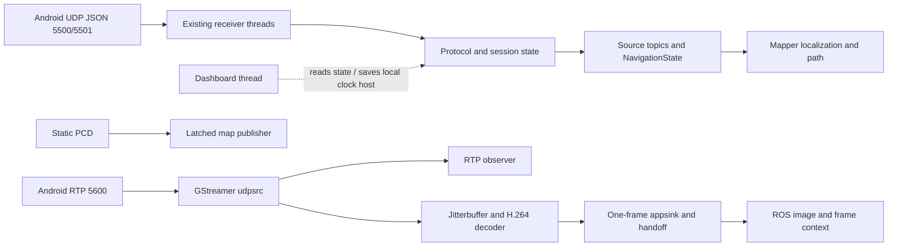
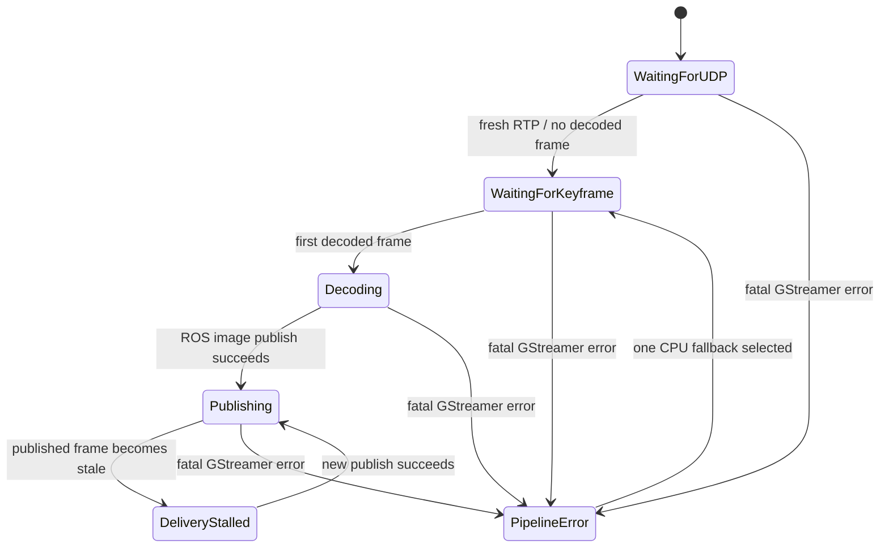
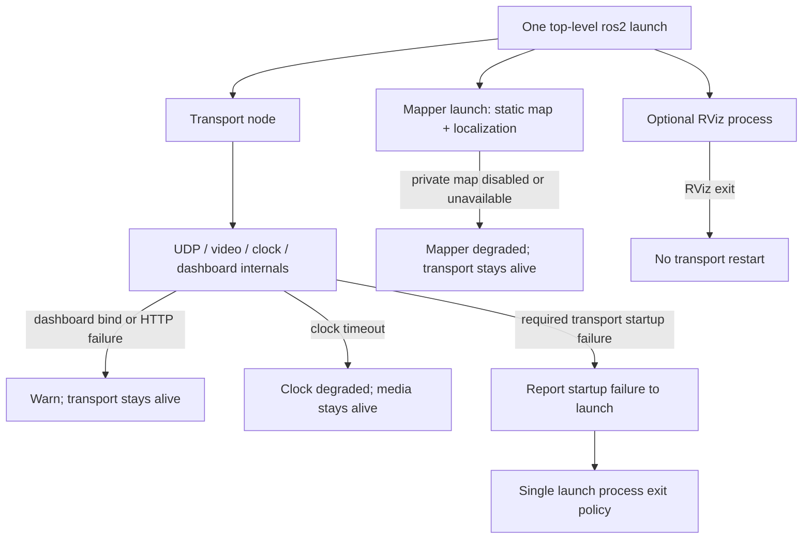
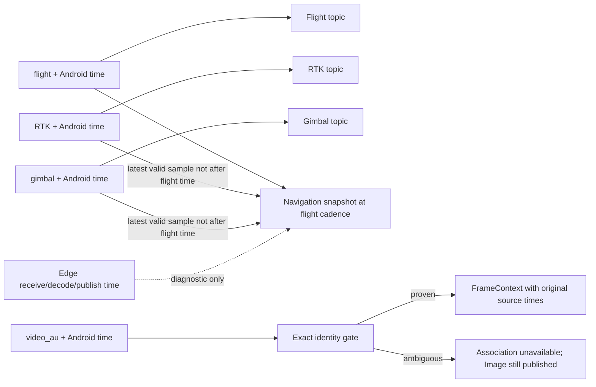
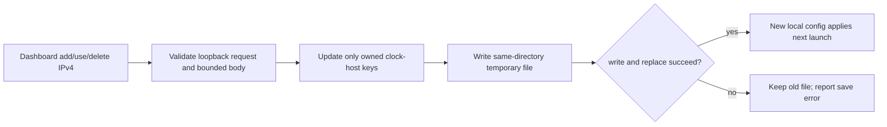

# Edge Transport Correctness and Release - Plan

## Goal Capsule

- **Objective:** An operator can tell which Edge stages are healthy, trust that ROS navigation preserves each Android source time, and see a map path that does not silently stop or claim an unproven frame/location match.
- **Means:** Correct the existing two-package Humble implementation at its current ownership boundaries; add focused regression coverage; keep the direct Primary pipeline and bounded dashboard.
- **Authority:** The Android app owns its wire contract and source timestamps. This repository owns Edge receipt, decode, ROS publication, map projection, dashboard, and deployment. Do not edit the Android SDK from this plan.
- **Execution profile:** Characterization-first and test-led. Preserve dirty user changes. Run package builds/tests only in this project’s Humble Docker service. Separate static and container proof from tablet, GPU, and field proof.
- **Stop conditions:** Stop before changing ports, RTP/JSON fields, source timestamps, adding a ROS package/node/relay, or making a guessed AU-to-image association. If exact frame identity cannot be proven, keep `FrameContext` unavailable and state that georeferenced detections are not ready.

## Product Contract

### Summary

This plan closes the six architecture/release concerns from the review and the additional source-backed correctness findings without re-creating the removed `dji_edge_driver` architecture. Several review labels describe an older layout: the current workspace already has `dji_edge_transport` and `dji_edge_mapper`, focused transport helpers, one top-level bringup with package launch files, and no shell restart loop. The plan fixes only the remaining, verified behavior and makes already-correct boundaries explicit.

### Problem Frame

The current direct path is intentionally small, but some status can contradict actual publication, RTP reordering can inflate gap counts, socket bind failures can look like a successful launch, clock replies are weakly matched, and source identity is not yet bound to decoded frames. Dashboard persistence can overwrite unrelated local parameters, while the mapper can misclassify bounds rejection and remain jump-gated after a long gap. Packaging and docs also do not fully describe the current runtime.

### Requirements

#### Transport and health

- R1. RTP continuity counters distinguish forward gaps, duplicates, reordering, late fills, wrap, and SSRC epochs. They describe packets observed at the existing GStreamer `udpsrc` probe; they never claim to prove Wi-Fi or network loss.
- R2. Primary status says `publishing` only after a ROS image has actually been published and remains fresh. Dashboard, ROS `TransportStatus`, and evidence use the same state definition.
- R3. Decoder status distinguishes selected backend, first decoded output, current decoded freshness, fatal pipeline error, and a completed fallback. Factory presence or an asynchronous `PLAYING` transition alone is not proof of a working NVIDIA decode.
- R4. Each existing UDP receiver reports bind/start/stop errors; shutdown is idempotent; an old-session packet accepted before a session transition cannot publish after the new session becomes active.
- R5. The Edge-originated clock exchange accepts only a reply matching the active request and tablet peer, ignores malformed/stale traffic until the bounded deadline, and reports a clock state independent of video. Port `5502` and the Android contract do not change.

#### Source time, navigation, and map

- R6. `flight`, `rtk`, `gimbal`, and `video_au` retain their Android/DJI source timestamps exactly. Edge receive/decode/publish time stays a separate diagnostic value; no synthesized common source timestamp replaces them.
- R7. A decoded image receives frame context only when the exact originating `video_au` identity is proven through the GStreamer path. No “latest RTP,” nearest AU, or current navigation sample can stand in for identity. Image publication continues when context is unavailable.
- R8. The individual telemetry topics remain independent. The composed navigation/path update follows a flight sample, overlaying only valid RTK and gimbal samples at or before that flight sample; a stale or invalid RTK sample falls back to the flight GPS fix so the path does not stop. Set the single RTK freshness bound from observed source cadence; do not guess it. RTK-only or gimbal-only packets do not advance the path.
- R9. Mapper status distinguishes invalid input, projection failure, out-of-map rejection, and jump rejection. A long gap or a new source session cannot leave the path permanently unable to resume; any segment across missing samples is described as an estimate, never a measured route.
- R10. The static PCD remains a one-time transient-local publication. Missing or invalid private map assets are reported as unavailable, not as a healthy empty map. Local map/calibration assets remain private and are selected explicitly rather than accidentally shadowed by stale install output.

#### Operator dashboard, configuration, and release

- R11. The dashboard is attempted automatically on normal transport startup, remains bound to loopback, and is non-fatal: if the page or HTTP thread fails, UDP, video, ROS, and mapper operation continue. Do not add a dashboard enable argument.
- R12. Dashboard state values are rendered as text, HTTP reads/writes are bounded, and saving a clock IP changes only dashboard-owned clock settings in the local overlay. Other local parameters survive; a failed save leaves the previous valid file intact. The setting remains “for next launch.”
- R13. The Edge remains exactly the current two packages and existing ROS process set; internal helpers may own focused responsibilities, but fixes add no ROS node, relay, video consumer, or periodic hot-path callback.
- R14. Humble package manifests, install layout, launch/config flow, Docker build context, protocol examples, and operator docs agree with the current implementation. Private evidence, map assets, credentials, and unrelated working-tree files are never staged as part of the fix.

### Review traceability

| Review item | Current checkout | Planned disposition |
| --- | --- | --- |
| 1. `EdgeBridge` god node | The old `dji_edge_driver`/`EdgeBridge` is absent. `TransportNode` coordinates existing `UdpReceiver`, `PrimaryVideoPipeline`, `ClockPinger`, evidence, state, and dashboard classes. | Correct behavior inside existing owners; keep `TransportNode` as coordinator. No broad rewrite or extra ROS nodes. U1–U5. |
| 2. Three startup/supervision layers | Current source has a top-level bringup and package launch files; no shell restart supervisor or restart marker exists in this checkout. | Do not recreate a loop or duplicate launch supervision. Define critical/degraded exit behavior in the top-level bringup and verify current included launches. U6–U7. |
| 3. Dashboard coupled to transport | `DashboardServer` runs on a loopback thread; start failure is already a warning, not a transport failure. | Keep default startup and current config capability; fix HTTP bounds, rendering, persistence, and state truth only. U5. |
| 4. Mapper split across C++ and Python | Static PCD publisher and continuous localization are different jobs in one package and one mapper launch. | Keep the two existing mapper nodes; clarify their shared config/topic contract and test failure/state behavior. Do not merge runtimes or add nodes merely to reduce file count. U6. |
| 5. Non-hermetic deployment | The project Compose build context is the repository root although the Dockerfile copies no source. | Scope the Edge build context to `docker/`; declare direct package dependencies and verify a clean install. U7. |
| 6. Fragmented configuration | Package YAML, C++/Python parameter defaults, and local overlays all participate in the effective config. | Trace each affected parameter; keep one canonical package YAML per package and explicit local overrides; remove only proven duplicate defaults. Dashboard writes only its owned field. U5–U7. |

Additional source-backed fixes are covered by R1–R14: RTP reorder accounting, truthful ROS/video health, receiver lifecycle/session fencing, clock matching, source-time retention, safe frame identity, flight-cadence navigation, mapper rejection/recovery, dashboard HTTP/config safety, golden packet consistency, dependency declarations, and local evidence references.

### Acceptance Examples

- AE1. For RTP sequence `100, 102, 101, 103`, the tracker reports reordering but no permanently missing packet; for `100, 102` with the configured observation horizon expired, it reports one gap observed at Edge. Covers R1.
- AE2. Fresh ingress and a decoded frame with no successful ROS publish is not `publishing`; a successful publish becomes fresh, and an old publish becomes stalled. Dashboard and ROS agree. Covers R2.
- AE3. NVIDIA factory exists but no frame has decoded: state says selected/awaiting output. A fatal NVIDIA bus error permits at most one CPU fallback; an ordinary RTP gap or stale-frame timeout never rebuilds the decoder. Covers R3.
- AE4. A malformed or wrong-peer clock datagram arrives before the valid matching pong: the exchange continues to the valid pong within its deadline. Clock readiness changes do not alter Primary state. Covers R5.
- AE5. RTK and gimbal samples arrive between flight samples: their individual topics update, but the path waits for the next flight sample and carries each original source time. Once RTK exceeds its evidence-derived freshness bound, navigation uses that flight sample's GPS fix, not the old RTK coordinate. A frame with ambiguous AU identity publishes its image with unavailable context. Covers R6–R8.
- AE6. A coordinate is outside map bounds: `rejected_outside_map` increments, not `rejected_projection`. After a long valid data gap, a plausible position can resume without an unbounded retry loop; the resulting line is explicitly only a sampled-path estimate. Covers R9–R10.
- AE7. An idle/partial/oversized dashboard client cannot hold shutdown or polling; untrusted session text renders literally; adding/selecting/deleting a host preserves unrelated YAML. If dashboard bind fails, video and ROS remain running. Covers R11–R12.

### Success Criteria

- Focused automated tests cover every behavior in AE1–AE7 and both packages pass their full Humble test suites.
- A clean project-container build resolves all package dependencies from declared metadata, not only from incidental Dockerfile packages.
- The primary graph remains one `udpsrc` → existing 20 ms jitter policy → H.264 decode → one-frame appsink → ROS image. No raw RTP recording, preview branch, competing port-5600 listener, or new payload copy is introduced.
- No source timestamp is overwritten. No frame/location match is published from an ambiguous identity.
- The 60-second live bench and 10-minute soak show independently readable ingress, decode, ROS publication, clock, navigation, and mapper states. Hardware/GPU success is claimed only after observing the target stream in the Humble container.
- The final push contains only reviewed plan-scope files and intended commits; unrelated dirty and untracked user data stays untouched.

### Scope Boundaries

- In scope: the current `src/dji_edge_transport`, `src/dji_edge_mapper`, their existing tests/messages/config/launch files, `docker/compose.yaml`, Dockerfile/package metadata, and the current operator/protocol documents.
- Not in scope: Android SDK changes; FPV support; port/RTP/JSON protocol changes; raw RTP/PCAP capture; changing bitrate/resolution/FPS; replacing UDP with TCP; preview windows; GPU-native ROS image transport; new ROS nodes/packages/relays; DDS tuning; automatic flight, mission, gimbal, takeoff, or landing actions.
- Deferred to follow-up work: remove old plans or historical references wholesale; remove component registration unless the consumer search proves it unused; redesign path visualization to encode disconnected trajectory segments; alter the 20 ms jitter latency or 2 MiB receive-buffer request; migrate away from Humble.
- Private map assets and `.runtime` captures remain local. They are never copied into docs or pushed merely to make a link resolve.

### Sources and Research

- Current source and tests: `src/dji_edge_transport/src/{rtp_ingress_tracker.cpp,primary_health_evaluator.cpp,primary_video_pipeline.cpp,udp_receiver.cpp,clock_pinger.cpp,source_time_state.cpp,transport_node.cpp,dashboard_server.cpp}` and matching `test/` files.
- Mapper source: `src/dji_edge_mapper/scripts/drone_localization_node.py`, `src/dji_edge_mapper/src/map_publisher.cpp`, current mapper config/launch, and `test/test_public_install_layout.py`.
- Local contract and operator docs: `docs/PROTOCOL_V1.md`, `docs/transport-contract-fixtures/primary-only/`, `deploy/protocol/v1/golden_packets.json`, `README.md`, `docs/PRIMARY_CPP_BENCH.md`, and `docs/TRANSPORT_RESOLUTIONS_AND_OPEN_ISSUES.md`.
- The older navigation-rate plan records flight-cadence path publication and independent RTK/gimbal inputs; carry that behavior forward, but use current `dji_edge_transport` paths rather than its removed `dji_edge_driver` paths: `docs/plans/2026-09-09-0600-fix-edge-preflight-and-navigation-rate-plan.md`.
- GStreamer streaming probes run in streaming context and must remain short/non-blocking: [pipeline manipulation](https://gstreamer.freedesktop.org/documentation/application-development/advanced/pipeline-manipulation.html). Preserve the bounded appsink contract and check the actual Humble image version before changing GStreamer properties: [appsink](https://gstreamer.freedesktop.org/documentation/app/appsink.html).
- `udpsrc` has an OS-capped socket buffer and uses pipeline running time, not Android source time: [GStreamer udpsrc](https://gstreamer.freedesktop.org/documentation/udp/udpsrc.html).
- ROS package dependency types must reflect build/runtime use: [REP-149](https://docs.ros.org/en/independent/api/rep/html/rep-0149.html). Build context is resolved relative to Compose and is the boundary of files sent to Docker: [Compose build specification](https://docs.docker.com/reference/compose-file/build/) and [Docker build context](https://docs.docker.com/build/concepts/context/).
- Use text-safe DOM construction for values influenced by UDP/dashboard state: [OWASP DOM XSS Prevention Cheat Sheet](https://cheatsheetseries.owasp.org/cheatsheets/DOM_based_XSS_Prevention_Cheat_Sheet.html). Socket writes must handle short writes and errors: [Linux `send(2)`](https://man7.org/linux/man-pages/man2/sendmsg.2.html).

## Planning Contract

### Key Technical Decisions

- KTD1. **Keep the existing two-package boundary and no additional ROS process** (session-settled: user-directed — chosen over splitting helpers into nodes: the user wants a minimal, reliable Edge and the current source already has focused internal helpers). Every unit changes existing package owners only.
- KTD2. **Android/DJI source timestamps stay immutable and per-source** (session-settled: user-directed — chosen over assigning a single Edge timestamp: the same-origin timestamp is needed for frame/navigation correlation; Edge times are diagnostics only). Cite this in U2 and U4.
- KTD3. **Frame context fails closed** (session-settled: user-directed — chosen over “latest RTP” matching: a wrong pose on a displayed frame is worse than unavailable context). Cite this in U4 and U6.
- KTD4. **Dashboard startup is automatic but non-critical** (session-settled: user-directed — chosen over a launch toggle or supervisor: the operator wants it available without making video/ROS depend on the page). It edits only the local clock-host setting for the next launch. Cite this in U5.
- KTD5. **Keep one bounded Primary media path**: retain the current 2 MiB `udpsrc` buffer request, 20 ms jitter policy, one-frame dropping appsink, CPU BGR ROS output, and no preview/recording. Do not adjust properties based on a generic tuning claim. Cite this in U1 and U3.
- KTD6. **Keep static map publishing and live localization separate within the existing mapper package**: their one-shot and per-sample lifecycles differ; one mapper launch owns startup. No new node or process split is added. Cite this in U6.
- KTD7. **A decoder fallback is event-bounded, not watchdog-based**: at most one NVIDIA-to-CPU attempt follows a fatal GStreamer error after NVIDIA was selected; packet gaps, absent RTP, or stale decode never restart it. If CPU also fails, expose stable degraded/error status and leave telemetry/other packages operating.

### High-Level Technical Design

#### 1. Existing component topology



No new node, listener, ROS message payload copy, or data-plane branch is introduced by the diagram.

#### 2. Normal data and clock protocol flow

```mermaid
sequenceDiagram
  participant T as Tablet
  participant E as Edge UDP/GStreamer
  participant R as ROS
  T->>E: telemetry / health / AU metadata (existing ports)
  T->>E: Primary H.264 RTP (5600)
  E->>E: validate session and count ingress observations
  E->>E: jitterbuffer, decode, retain newest frame
  E->>R: Image; FrameContext only if exact AU identity is proven
  E->>T: clock_ping on 5502 from temporary source port
  T-->>E: matching clock_pong to that same source tuple
  E->>E: validate peer + request identity; update clock estimate
```

The fixed Edge listener on `5502` remains governed by the documented Android-initiated direction; it is not used as the return path for an Edge-originated ping. No reply schema is invented.

#### 3. Primary health state machine



Clock readiness is a separate state and never changes Primary health.

#### 4. Process lifecycle and failure ownership



Do not add a shell restart loop, dashboard restart marker, or independent timer that rebuilds a healthy decoder after ordinary packet loss.

#### 5. Decision policy for ambiguous signals

| Observation | Report | Do not infer |
| --- | --- | --- |
| Sequence discontinuity at GStreamer source probe | RTP sequence anomaly/gap after bounded reorder policy | Wi-Fi loss or Android send failure |
| Fresh RTP but no decoded frame | waiting for keyframe or decoder error, according to bus/frame evidence | that UDP is absent |
| Decoder selected but no output frame | selected/awaiting output | GPU hardware is actively decoding |
| No exact RTP/AU-to-decoded-frame match | context unavailable | location from the latest packet |
| Local map file missing | map unavailable and reason | that an empty map is valid |

#### 6. Source timestamp data flow



#### 7. Local configuration save lifecycle



### Assumptions

- The checked-in protocol fixtures and `docs/PROTOCOL_V1.md` describe the current Android contract; when they conflict with the deployed golden example, the committed Android-compatible fixtures and decoder tests are the baseline to reconcile. No Android SDK changes are authorized here.
- The project’s Humble container is the only build/test environment for ROS packages. Docker operations must use `docker/compose.yaml` and must not modify other services/images.
- The 2 MiB receive-buffer request, 20 ms jitter setting, `appsink max-buffers=1 drop=true`, current ROS topics, and private map boundary remain the baseline.
- The checkout is dirty and ahead of its upstream by three commits at planning time. Re-read status and inspect the outgoing commit range immediately before any later stage/push.

### Risks and Dependencies

| Risk | Mitigation |
| --- | --- |
| Reorder accounting can still call a packet “missing” after its bounded horizon although it may arrive later | Name the horizon and metric as an ingress observation; never call it network loss. |
| GStreamer PTS/metadata may not prove AU/image identity under wrap, repeated timestamps, loss, or B-frame ordering | Keep context unavailable unless deterministic and real-stream tests prove a one-to-one association. |
| NVIDIA pipeline failure may not provide a recoverable bus state | Attempt only one CPU fallback after fatal error; preserve the final error and keep telemetry/mapper alive if video cannot recover. |
| Dashboard configuration may contain non-dashboard YAML settings | Preserve unrelated content and replace atomically; reject unsupported layouts without overwriting. |
| A local map may be absent or stale in an installed share directory | Require explicit local asset selection and test both clean public-disabled and local-enabled layouts. |
| Pushing the branch also publishes its three current unpushed commits | Review every outgoing commit and staged path before push; stop if the range contains unrelated or unsafe content. |

### Key Flows

1. Startup binds the existing receivers, starts the direct Primary pipeline, creates ROS publishers, and attempts the dashboard. Receiver/pipeline errors are reported at their own boundary; dashboard failure is non-fatal.
2. Telemetry is validated and session-fenced, each source topic publishes its original sample time, and only a flight sample produces the composed navigation snapshot/path input.
3. RTP metrics observe the existing source pad, GStreamer retains only the latest decoded frame, and frame context is populated only when exact AU identity is established.
4. The operator dashboard reads shared state without owning transport lifecycle. Its local clock-host save is validated, atomic, and applies on the next launch.
5. Static map assets publish once with transient-local QoS. Localization projects valid position samples and reports why any sample was rejected.

## Implementation Units

### U1. Correct RTP sequence accounting and protocol fixtures

- **Goal:** Make sequence continuity measurements stable under normal packet reordering and stream epoch changes.
- **Requirements:** R1, R2; KTD1, KTD5.
- **Dependencies:** None.
- **Files:** `src/dji_edge_transport/include/dji_edge_transport/rtp_ingress_tracker.hpp`, `src/dji_edge_transport/src/rtp_ingress_tracker.cpp`, `src/dji_edge_transport/test/test_rtp_ingress_tracker.cpp`, `src/dji_edge_transport/include/dji_edge_transport/primary_video_pipeline.hpp`, `src/dji_edge_transport/src/transport_node.cpp`, `src/dji_edge_transport/test/test_protocol_decoder.cpp`, `deploy/protocol/v1/golden_packets.json`, and only the directly affected metric docs.
- **Approach:** Keep the tracker at the current GStreamer source probe. Track the sequence high-water mark per SSRC epoch; use a fixed bounded reorder horizon; allow late packets inside the horizon to fill provisional holes; keep totals across epochs without comparing one SSRC’s sequence to another. Expose the horizon/epoch semantics in status labels and docs. Reconcile the deploy health example to the documented `health:0` direct-counter shape and add a test that parses that exact example.
- **Test scenarios:** in-order input has zero gaps; a forward jump records a provisional hole; a late fill within the horizon clears it; a late packet beyond the horizon is counted as reordered without moving the high-water mark; duplicate does not change the high-water mark; `65535 → 0 → 1` wraps correctly; SSRC change resets continuity but does not create a cross-epoch gap; malformed headers remain rejected.
- **Verification:** `test_rtp_ingress_tracker` and protocol fixture tests pass; only the existing Primary socket owner observes RTP; dashboard/status call the metric an Edge observation.

### U2. Make UDP lifecycle, sessions, and clock exchanges reliable

- **Goal:** Surface failed listeners and prevent stale or unrelated datagrams from corrupting current session or clock state.
- **Requirements:** R4–R5; KTD1–KTD2.
- **Dependencies:** U1.
- **Files:** `src/dji_edge_transport/include/dji_edge_transport/udp_receiver.hpp`, `src/dji_edge_transport/src/udp_receiver.cpp`, `src/dji_edge_transport/include/dji_edge_transport/clock_pinger.hpp`, `src/dji_edge_transport/src/clock_pinger.cpp`, `src/dji_edge_transport/include/dji_edge_transport/protocol_decoder.hpp`, `src/dji_edge_transport/src/protocol_decoder.cpp`, `src/dji_edge_transport/src/transport_node.cpp`, `src/dji_edge_transport/test/test_clock_pinger.cpp`, `src/dji_edge_transport/test/test_protocol_decoder.cpp`, and `src/dji_edge_transport/test/test_transport_node.cpp`.
- **Approach:** Make bind readiness/errors observable to `TransportNode`; ensure each receiver thread owns/closes its descriptor safely and repeated stop is harmless. Contain callback failures at the thread boundary. Fence publications by accepted session so a transition cannot be followed by data from the retired session. For Edge-originated clock exchange, validate peer IPv4 plus session, stream, sequence, and `t0`; receive until the configured deadline so a bad/unmatched packet does not consume a later valid pong. Keep the same ports and request/reply direction. The fixed `5502` listener only answers Android-initiated requests if the existing documented request format provides the required time semantics; otherwise it reports unsupported/malformed input without inventing a response.
- **Test scenarios:** successful and occupied-port bind; immediate and repeated start/stop; socket-creation failure; callback exception does not silently kill the receiver; old-session packet is fenced during concurrent transition; matching clock reply succeeds; wrong peer/session/sequence/t0 and malformed packet are ignored until timeout or a valid reply; timeout and send failure are distinct; pinger shutdown remains bounded.
- **Verification:** focused receiver/clock/session tests pass. A clock timeout changes only clock readiness; video and mapper are not restarted or blocked.

### U3. Report true Primary and decoder health without a watchdog

- **Goal:** Make the dashboard and ROS state reflect actual decoded and published frames, including GPU selection and fatal pipeline failure.
- **Requirements:** R2–R3; KTD1, KTD5, KTD7.
- **Dependencies:** U1–U2.
- **Files:** `src/dji_edge_transport/include/dji_edge_transport/primary_health_evaluator.hpp`, `src/dji_edge_transport/src/primary_health_evaluator.cpp`, `src/dji_edge_transport/include/dji_edge_transport/primary_video_pipeline.hpp`, `src/dji_edge_transport/src/primary_video_pipeline.cpp`, `src/dji_edge_transport/msg/TransportStatus.msg`, `src/dji_edge_transport/src/transport_node.cpp`, `src/dji_edge_transport/test/test_primary_health_evaluator.cpp`, `src/dji_edge_transport/test/test_primary_video_pipeline.cpp`, `src/dji_edge_transport/test/test_transport_node.cpp`.
- **Approach:** Make “never published” distinct from “freshly published” and share one evaluator for ROS status, dashboard, and transition evidence. Distinguish decoder selected, first frame decoded, last decoded age, fallback backend, and terminal error. Keep startup CPU fallback when NVIDIA cannot start. Permit one CPU fallback only after a fatal bus error from the selected NVIDIA pipeline; never rebuild on packet gaps, missing IDR, or stale-frame watchdog. If CPU fails, expose a stable error while telemetry and mapper remain available. Poll the existing bus at its current status path; do not add a streaming callback or decoder-health timer.
- **Test scenarios:** no ingress; ingress without first decoded frame; decoded but never ROS-published; fresh publish; stale publish; successful publish recovery; factory present without output; startup NVIDIA failure to CPU; one runtime NVIDIA fatal error to CPU; CPU fallback error; ordinary RTP gap does not restart either pipeline; one-frame handoff remains newest-only.
- **Verification:** focused evaluator and pipeline tests pass. In the Humble image, confirm the installed GStreamer properties and inspect decoder bus/state behavior. A real tablet/GPU bench is required before reporting hardware decode as verified.

### U4. Preserve per-source time and gate exact frame context

- **Goal:** Provide the mapper and future detection pipeline with source-time-faithful navigation and never attach an unrelated pose to an image.
- **Requirements:** R6–R8; KTD1–KTD3.
- **Dependencies:** U1–U3.
- **Files:** `src/dji_edge_transport/msg/NavigationState.msg`, `src/dji_edge_transport/msg/FrameContext.msg` only if an existing field is insufficient, `src/dji_edge_transport/include/dji_edge_transport/source_time_state.hpp`, `src/dji_edge_transport/src/source_time_state.cpp`, `src/dji_edge_transport/include/dji_edge_transport/frame_context_builder.hpp`, `src/dji_edge_transport/src/frame_context_builder.cpp`, `src/dji_edge_transport/src/transport_node.cpp`, `src/dji_edge_transport/test/test_source_time_state.cpp`, `src/dji_edge_transport/test/test_frame_context_builder.cpp`, `src/dji_edge_transport/test/test_transport_node.cpp`, and affected fixture/docs.
- **Approach:** Before implementation, inspect available Edge evidence for RTK source inter-arrival cadence; if it is absent, record the freshness bound as unverified and keep using flight GPS rather than treating an old RTK sample as current. Set one documented RTK age bound from observed source cadence, not an arbitrary dashboard knob. Carry the RTK sample’s Android time into composed `NavigationState` alongside existing flight and gimbal times. Publish independent flight/RTK/gimbal source topics as they arrive, but publish the map-facing composed snapshot only on a flight sample, selecting RTK/gimbal only when their Android time is not later than that flight sample and the RTK sample remains within its bound. Investigate whether RTP timestamp/SSRC identity survives depay, parser, and decode with one-to-one semantics; join bounded metadata to a decoded frame only when that proof holds. Use Android AU-complete monotonic time for source-history selection; keep Edge ROS header, receive time, decode time, and clock offset diagnostic only.
- **Test scenarios:** samples out of order or from a retired session are not composed; RTK coordinates retain the exact RTK time; a fresh RTK sample is selected, then expires at the configured age bound and GPS fallback retains the flight timestamp; RTK/gimbal-only packets update their own topics but not the path cadence; frame selection chooses only samples at/before that AU time; loss, wrap, duplicate RTP timestamp, B-frame reorder, or session ambiguity leaves context unavailable while image is still published.
- **Verification:** C++ tests assert every source timestamp byte-for-byte and no Edge timestamp is substituted; tests also show that stale RTK falls back to the current flight GPS fix without stopping path publication. A deterministic H.264 integration fixture must demonstrate exact AU/image identity. If it cannot, keep `ASSOCIATION_UNAVAILABLE`; do not mark georeferenced frame context ready.

### U5. Harden the always-available dashboard and its config save

- **Goal:** Keep the operator page useful without giving it control of transport lifecycle or risking local settings.
- **Requirements:** R2, R5, R11–R12; KTD4.
- **Dependencies:** U2–U4.
- **Files:** `src/dji_edge_transport/include/dji_edge_transport/dashboard_server.hpp`, `src/dji_edge_transport/src/dashboard_server.cpp`, `src/dji_edge_transport/src/transport_node.cpp`, `src/dji_edge_transport/test/test_transport_node.cpp`, add a focused dashboard server test in the existing package test structure, and `src/dji_edge_transport/CMakeLists.txt` only for that test target.
- **Approach:** Keep loopback binding, automatic startup attempt, non-fatal failure, and next-launch config application. Make clock state derive only from clock freshness/outcomes. Read one bounded HTTP request with finite client timeout and body limit; reject incomplete/oversized/invalid requests. Complete socket writes or fail cleanly. Render all dynamic state via text nodes/`textContent`. Update only the managed clock-host keys in the existing local YAML and replace atomically from the same directory; preserve unrelated YAML and leave the prior file intact on any write/rename failure.
- **Test scenarios:** valid GET/POST; fragmented but complete request; idle client followed by another request and shutdown; malformed JSON; missing/oversized content length; unsupported method/action; invalid IPv4; literal rendering of HTML-like session/error data; add/use/delete host; unrelated parameter and comment survive update; failed temp write/rename leaves old file; dashboard bind failure does not change transport state; clock timeout does not change video state.
- **Verification:** focused HTTP/config tests and a browser smoke at normal laptop width confirm live tabs, clock state, and saved-host behavior. The dashboard remains optional at runtime and is not given a start/stop command-line toggle.

### U6. Make mapper state and path recovery honest

- **Goal:** Keep the static map one-shot, make mapper availability diagnosable, and make accepted path samples resume after a temporary input gap.
- **Requirements:** R8–R10; KTD1, KTD3, KTD6.
- **Dependencies:** U4.
- **Files:** `src/dji_edge_mapper/scripts/drone_localization_node.py`, `src/dji_edge_mapper/src/map_publisher.cpp`, `src/dji_edge_mapper/launch/dji_edge_mapper.launch.py`, `src/dji_edge_mapper/launch/dji_edge_bringup.launch.py`, `src/dji_edge_mapper/config/mapper.yaml`, `src/dji_edge_mapper/config/mapper.local.yaml.example`, `src/dji_edge_mapper/rviz/dji_edge_mapper.rviz` only if the current operator config needs a path-preserving adjustment, `src/dji_edge_mapper/test/`, `src/dji_edge_mapper/CMakeLists.txt`, and `src/dji_edge_mapper/package.xml` only for required test/dependency metadata.
- **Approach:** Return an explicit rejection reason from projection/bounds validation and increment the matching counter. Keep map PCD publication transient-local and one-shot, but publish/log an unambiguous unavailable state when the configured private map cannot load. Make the local mapper overlay/path explicit in the supported bringup flow, with installed defaults disabled when no private assets exist. Use the original same-session Android flight timestamp for jump-gate elapsed time after validating monotonicity; do not clamp a long outage to the existing 10-second ceiling. Define bounded reacquisition and expose a gap/rejection counter; do not insert synthetic route points or claim the straight connection across sparse samples is the actual flight path. Retain the existing map publisher and localization processes in one mapper launch.
- **Test scenarios:** valid/in-bounds RTK and GPS fallback; invalid coordinate; projection failure; outside-map point; valid normal-speed movement; implausible jump rejected; plausible movement after long gap resumes; source session change resets the jump baseline without clearing old map-independent evidence; missing/invalid PCD reports unavailable; a loaded map is published once and remains available to late transient-local subscribers; no private map file is installed or committed.
- **Verification:** add focused mapper tests for projection/rejection counters and gap recovery; retain the install-layout test; test public-disabled and local-enabled launch config. On the operator map, confirm the existing thick/billboard path styling and pose topics remain intact.

### U7. Align package, Docker, config, and operator documentation

- **Goal:** Make a fresh project-container build and operator setup use the same explicit configuration and dependency contract as the current source.
- **Requirements:** R13–R14; KTD1, KTD4–KTD6.
- **Dependencies:** U1–U6.
- **Files:** `src/dji_edge_transport/package.xml`, `src/dji_edge_transport/CMakeLists.txt`, `src/dji_edge_mapper/package.xml`, `src/dji_edge_mapper/CMakeLists.txt`, `docker/compose.yaml`, `docker/Dockerfile` only if dependency install list changes, `README.md`, `docs/PROTOCOL_V1.md`, `docs/TRANSPORT_RESOLUTIONS_AND_OPEN_ISSUES.md`, `docs/FUTURE_TODO.md`, `deploy/protocol/v1/golden_packets.json`, and `src/dji_edge_mapper/test/test_public_install_layout.py`.
- **Approach:** Trace every direct CMake/runtime dependency and declare valid rosdep keys with correct dependency types; verify each key in the Humble container rather than guessing package names. Set the Edge Compose build context to `docker/` and update its paired Dockerfile path to `Dockerfile` (both paths resolve relative to the Compose file/context respectively), retaining the existing service, host networking, workspace mount, NVIDIA capability, and all unrelated containers. Keep package YAML canonical and local overlays explicit. Correct only stale docs confirmed by source: no old driver path, no implied automatic mapper local file load unless implemented, no broken clickable links to ignored session evidence, no outdated component use claim. Remove `rclcpp_components` registration/dependency only if a repository-wide consumer search confirms it is unused; do not delete historical plans or private assets.
- **Test scenarios:** `docker compose config` contains the same single Edge service and no change to other Compose files; build context excludes `.runtime`, `build/`, `install/`, `log/`, private maps, and user images; package metadata resolves GStreamer/PkgConfig/PCL/pyproj dependencies; installed public layout has no private map; docs describe dashboard default/nonfatal behavior, local config, topics, ports, and timestamp semantics accurately.
- **Verification:** run `rosdep check --from-paths src --ignore-src -r` in the Humble container; build both packages from a clean generated-artifact state; run the full test suite; inspect installed launch/config/assets. Preserve user data and prove no unrelated files entered the release diff.

### U8. Run layered acceptance and ship the scoped change

- **Goal:** Verify reproducibly, then push only the reviewed Edge changes and report any hardware gate that remains.
- **Requirements:** R1–R14.
- **Dependencies:** U1–U7.
- **Files:** All U1–U7 scope files; no broad generated artifact or local evidence files.
- **Approach:** Re-read `git status`, inspect every dirty/untracked path, and compare the outgoing commit range with upstream before staging. For generated `build/`, `install/`, or `log/`, inspect contents and remove only if verified to be disposable colcon output; never remove `.runtime`, private map assets, images, or unknown data. Build/test both packages in the project Humble container, launch headless, then run the 60-second props-off stream bench and 10-minute soak when the tablet is available. Record test commands/results and unresolved hardware requirements in the existing report. Stage explicit files only—never `git add .`. Commit and push only after reviewing the staged diff and all commits that the push will publish; no amend, rebase, force push, or merge.
- **Test scenarios:** no-tablet launch stays alive and reports waiting input; local dashboard can be unavailable without transport failure; static map/localization config behaves as documented; live Primary shows actual decoder selection/first output/ROS publication; clock freshness is separate; stream interruption does not trigger a frame-loss watchdog; session transition clears stale sources; after recovery the path resumes under the tested gap policy.
- **Verification:** `docker compose -f docker/compose.yaml config`; `docker compose -f docker/compose.yaml build dji_edge_humble`; inside the project container, `source /opt/ros/humble/setup.bash`, `cd /workspace`, `rosdep check --from-paths src --ignore-src -r`, `colcon build --packages-select dji_edge_transport dji_edge_mapper --symlink-install --cmake-args -DCMAKE_BUILD_TYPE=Release`, `colcon test --packages-select dji_edge_transport dji_edge_mapper`, and `colcon test-result --verbose`. Then run `ros2 launch dji_edge_mapper dji_edge_bringup.launch.py rviz:=false` for no-tablet startup and the live bench with private map settings. Before push, inspect `git diff --check`, `git diff --cached`, `git status`, and `git log --oneline @{u}..HEAD`; push the current branch only if its full outgoing range is in scope.

## Verification Contract

| Gate | Pass evidence |
| --- | --- |
| G0 — scope and dirty-state preflight | Current branch, upstream range, all dirty/untracked files, ignored generated directories, private maps, and `.runtime` are inventoried. No unrelated change is overwritten or staged. |
| G1 — focused C++ regressions | RTP reorder/wrap/SSRC, protocol fixture, clock matching, receiver lifecycle, session fencing, health-state, source-time, and frame-context tests pass. |
| G2 — focused mapper/dashboard regressions | Projection/bounds/jump recovery, map load/latched delivery, config persistence, bounded HTTP, and dashboard state tests pass. |
| G3 — clean Humble dependency/build/test | Compose validates; `rosdep check` resolves; both packages build and all tests pass in the project service; installed launch and public asset layout are correct. |
| G4 — no-tablet launch | Transport remains alive in waiting state; no unhandled bind/pipeline failure; dashboard is attempted and non-fatal; local map disabled/missing is explicit. |
| G5 — live primary/GPU bench | On the target tablet and Humble GPU container, record ingress/decode/published FPS, actual decoder selection and first output, pipeline errors, clock state, and ROS topic freshness. Run 60 seconds then 10 minutes; do not change Android bitrate/FPS/IDR or jitter settings during this plan. |
| G6 — synchronized frame/map gate | A known H.264 stream and its AU metadata demonstrate exact decoded-frame identity and source-time selection. If not proven, every context remains unavailable and the run is explicitly not georeferencing-ready. |
| G7 — release review | Staged files are explicit and scoped; the full branch push range is reviewed; no `.runtime`, PCAP/NDJSON, private map, user image, secret, or unrelated Docker project is included. |

## Definition of Done

- U1–U8 are completed in dependency order, and G1–G4 pass before a push.
- The existing two packages, ports, Android wire payload, source clocks, 2 MiB receive-buffer request, 20 ms jitter policy, one-frame appsink, and private map boundary remain intact.
- Primary health, decoder selection/output, ROS delivery, clock, map, and dashboard states are truthful and independently testable. No loss-triggered decoder watchdog or extra media consumer exists.
- Navigation publishes at flight cadence with independent flight/RTK/gimbal source timestamps. Frame context never falls back to a recent packet; an unproven match remains unavailable.
- RTK is never carried forward indefinitely: after the evidence-derived freshness bound it falls back to flight GPS; if no trustworthy RTK cadence is observed, GPS remains authoritative.
- Mapper rejection reasons and long-gap behavior are covered by tests; the static PCD remains one-shot and transient-local.
- Dashboard writes are bounded and atomic, preserve other local parameters, and cannot block transport or its shutdown.
- Documentation, declared dependencies, install layout, and Edge-only Docker context match the current two-package implementation. Abandoned attempts are removed; unrelated user changes remain untouched.
- The scoped commits are pushed without force and the pushed commit range is reported. The result is called field-ready only if G5 passes; it is called georeferencing-ready only if G6 passes.

## Appendix

### Deferred findings and known limits

- A sequence gap remains an Edge observation even after the reorder horizon; only paired Android/Edge capture can attribute where packets disappeared.
- `sensor_msgs/Image` still requires CPU message storage/copy; zero-copy/GPU-native transport is not part of these correctness changes.
- If GStreamer does not preserve a deterministic AU identity through decode, the safe outcome is unavailable frame context, not a new relay or protocol guess.
- A `nav_msgs/Path` connects sampled points with straight segments. This plan prevents permanent jump-gate lockout and documents gaps; a dedicated disconnected-segment visualization is a separate design change.
- Humble support horizon and any ROS distro migration are release planning, not a reason to expand this fix.
